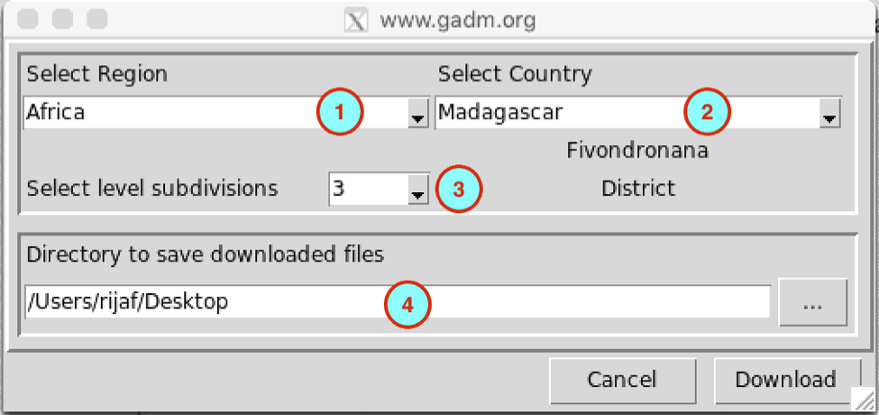

<!-- MathJax -->

# Observational Data Readiness

## ENACTS Construction and Rain Gauge Analysis

### 1. ENACTS Construction Process
- Share the step-by-step methodology for constructing ENACTS.
- Demonstrate how to effectively merge and calibrate ground-based rain gauge data with satellite products.

### 2. Gridding and Case Studies
- Showcase how to grid different levels of station density with satellite data.
- Walk through relevant case studies to illustrate the practical application of this gridding process.

### 3. Rain Gauge Analyses
- Dedicate a focused segment to running and interpreting rain gauge analyses.
- Discuss how these local analyses inform broader observational data readiness and model validation.

# CDT Exercise
## Download Data
## Download Country Administrative Boundaries

The menu **Data Preparation** ‣ **Download Country boundary** allows you to download country outlines and administrative subdivisions for countries in Africa from [GADM data](https://gadm.org/index.html).

1. Select the region where the country is located.
2. Select the country from the drop-down list.
3. Select the administrative subdivisions to download.
   
   **0** is the country boundaries,
   
   **1** is the first subdivision (example: Region),
   
   **2** is the second subdivision (example: District),
   
5. Specify the folder to save the downloaded ESRI shapefile by browsing to it using the browse button  or typing the full path to the folder.

