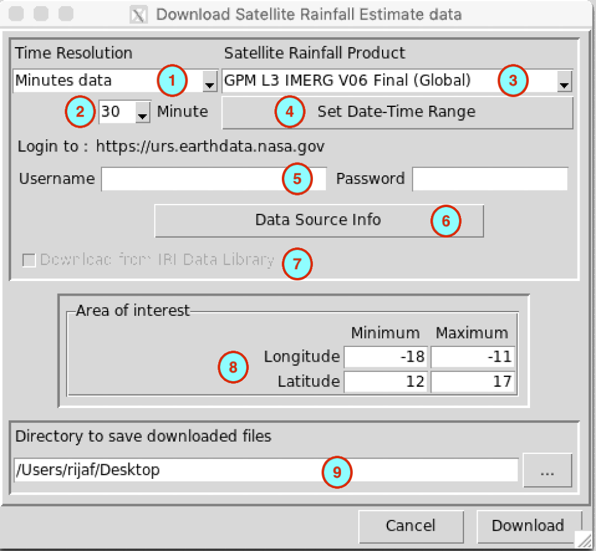
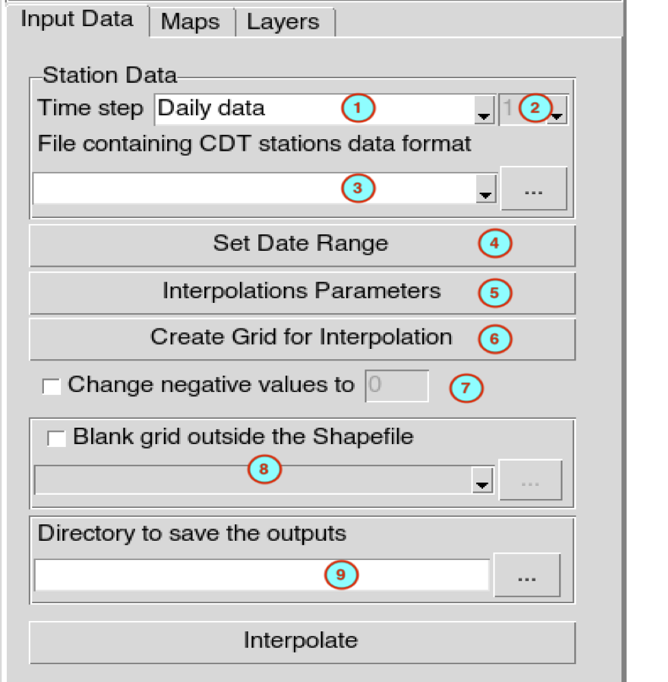
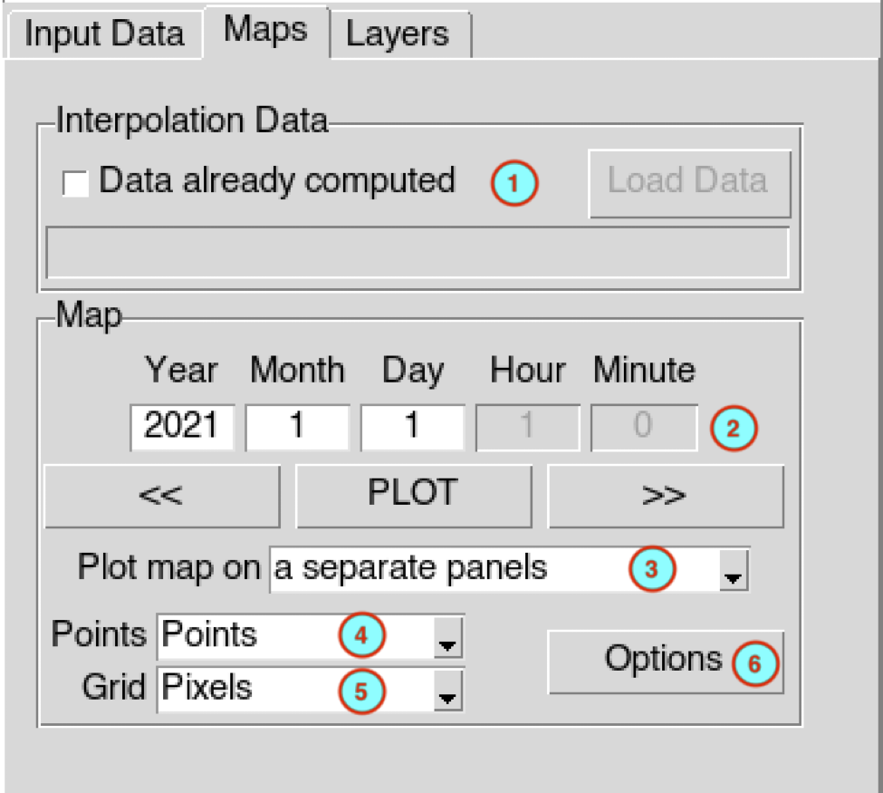
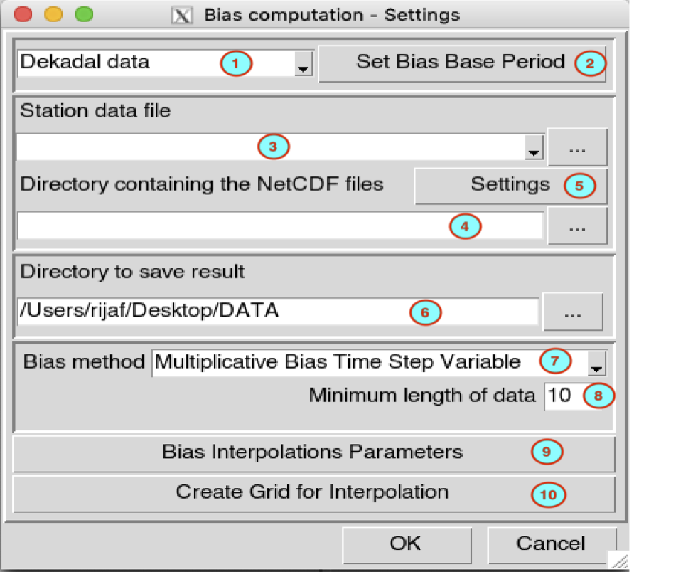
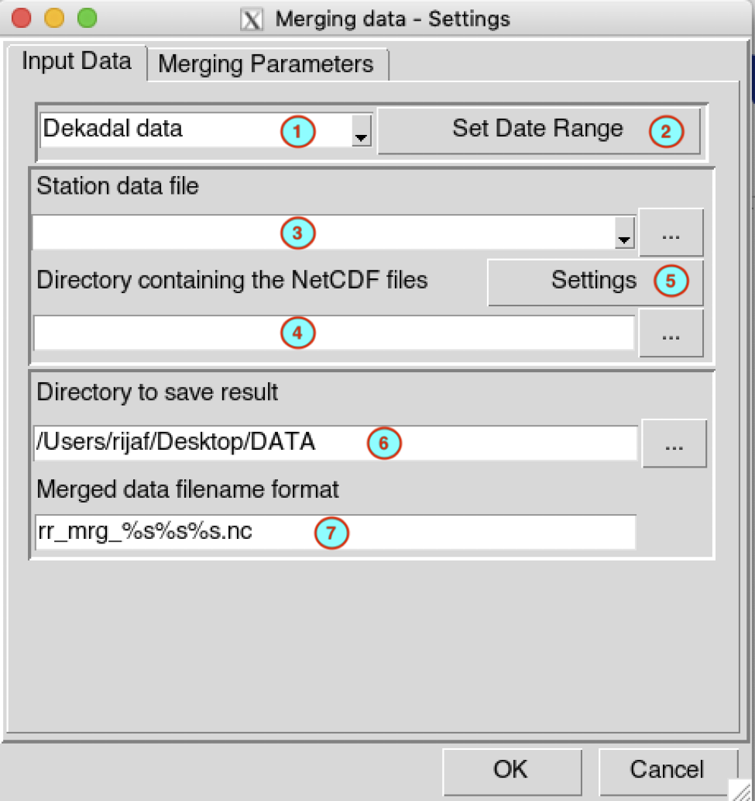
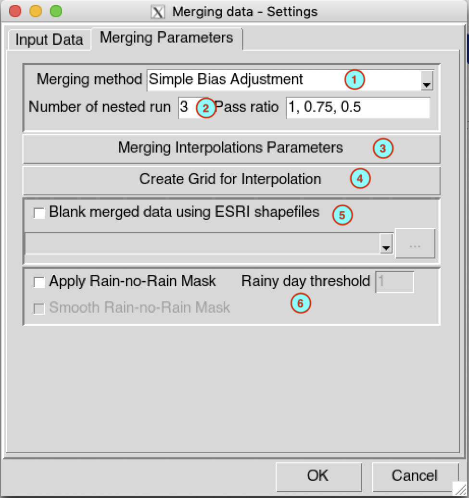
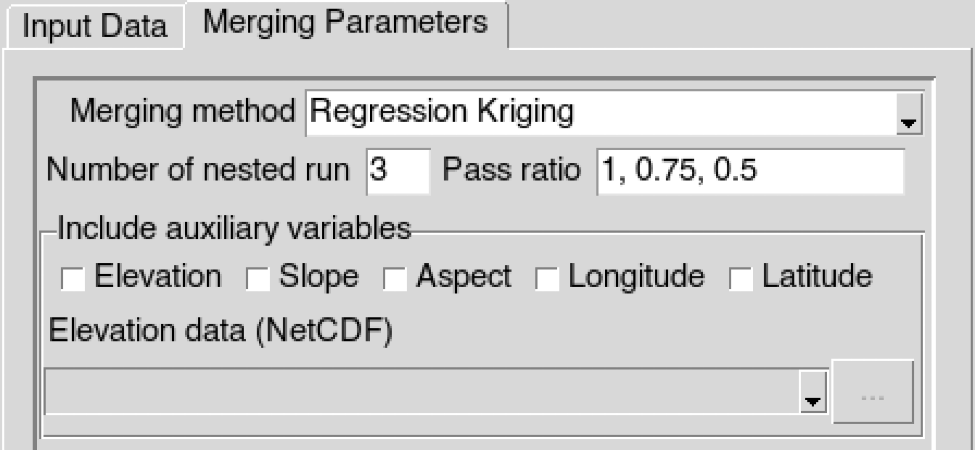
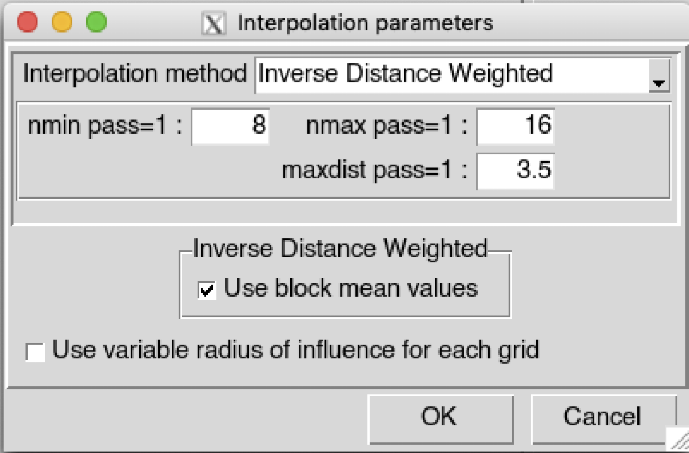

<!-- MathJax -->
<script type="text/javascript" src="https://cdnjs.cloudflare.com/ajax/libs/mathjax/2.7.3/MathJax.js?config=TeX-AMS-MML_HTMLorMML"></script>

# Observational Data Readiness

## Download Data
## Download Country Administrative Boundaries

The menu [**Data Preparation** ‣ **Download Country boundary**]() allows you to download country outlines and administrative subdivisions for countries in Africa from [GADM data](https://gadm.org/index.html).


1. Select the region where the country is located.
2. Select the country from the drop-down list.
3. Select the administrative subdivisions to download.
   
   **0** is the country boundaries,
   
   **1** is the first subdivision (example: Region),
   
   **2** is the second subdivision (example: District),
   
4. Specify the folder to save the downloaded ESRI shapefile by browsing to it using the browse button Score:  or typing the full path to the folder.


## Download Satellite Rainfall Estimates data 

The menu Data Preparation ‣ Download Data ‣ Download Satellite Rainfall Estimates data   allows to download satellite rainfall products from 30 minutes to monthly temporal resolution.




1.	Select the temporal resolution of the satellite rainfall estimate product to download.
2.	In case of minutes or hourly data, select here the time step.
3.	Select the satellite rainfall estimate product to download.
4.	Set the date and time range of the data to download. See [Setting date range](https://iri.columbia.edu/~rijaf/CDTUserGuide/html/cdt_data_input.html#cdt.date.range) for more details.
5.	If the satellite rainfall estimate product requires a login to download the data, enter here the user name and the password you use to log in to your account. The URL of the website for login is displayed next to the label Login to. If you do not have an account yet, you can sign up to this URL.
6.	Click this button to display the information about the data. It will open your default web browser and display the link to the data or relevant information about the data.
7.	In case of this checkbox is activated, check it if you want to download the data from the Data Library of IRI. The IRI Data Library allows you to subset the data before downloading it into your computer, and it makes the download faster.
8.	Set the bounding box of the area to be downloaded. Type in the fields the minimum and maximum of the longitude and latitude in degree decimal.
9.	Specify the folder to save the downloaded rainfall data by browsing it from the button  or typing the full path to the folder.

A folder containing the downloaded data will be created under the directory you provided in (9). This folder is created from the name of the satellite rainfall estimate product and the time step of the data


## Spatial Interpolation

A spatial interpolation is the estimation of the unknown value of a point by using the measured points in the study area. To interpolate a spatial points data (stations observation) into gridded data, use the menu Gridding ‣ Spatial Interpolation. It displays a tabbed widget on the left panel, allows to enter the inputs data, set the interpolation parameters and display maps of the interpolated data.

The tab Input Data allows to specify the input station data and the interpolation parameters.




1.	Select the temporal resolution of the input data in CDT stations data format. The available temporal resolution are: minutes, hourly, daily, pentad, dekadal, monthly data and others (seasonal, annual, …).
2.	In case of minutes and hourly, select here the time step of the input data.
3.	Select the CDT station data to interpolate with the drop down list if it is already loaded, or open it through   …  .
4.	Set the start and end date of the period to interpolate. See [setting date range](https://iri.columbia.edu/~rijaf/CDTUserGuide/html/cdt_data_input.html#cdt.date.range) for more details.
5.	Click on the button   Interpolation Parameters   to set the parameters to be used to interpolate the station data. It opens a dialog box.
 > CDT has 7 spatial interpolation methods: Inverse Distance Weighted, Ordinary Kriging, Universal Kriging, Modified Shepard interpolation, Spheremap interpolation method, Nearest Neighbor and Nearest Neighbor with elevation - 3D.

 > By default CDT uses a local interpolation technique, therefore, you have to provide the minimum and maximum number of stations used to interpolate a grid point, and the maximum distance within which the stations are selected. See the [spatial interpolation methods](https://iri.columbia.edu/~rijaf/CDTUserGuide/html/interpolation_methods.html#interp.local) for further details, and the [interpolation dialog](https://iri.columbia.edu/~rijaf/CDTUserGuide/html/interpolation_dialog.html) to select the method to be used and set the interpolation parameters.

6.	Click on the button   Create Grid for Interpolation   to provide the grid to be used to interpolate the data. It will display the [grid creation](https://iri.columbia.edu/~rijaf/CDTUserGuide/html/interpolation_grid.html) dialog box.
7.	In the case where the variable to be interpolated cannot be negative or below a certain value, check    Change negative values to    , enter the value you want to change the negative values in the activated input field.
8.	To mask the grid outside a given polygons, check    Blank grid outside the Shapefile    , this will activate the drop down list below allowing you to provide the Shapefile to be used. See the [blanking options](https://iri.columbia.edu/~rijaf/CDTUserGuide/html/blanking_options.html) to control the buffer outside the polygons.
9.	Specify the folder to save the output by browsing it from the button  or typing the full path to the folder.

When you finish to set everything in this tab, click on the button Interpolate to start the interpolation process.


This creates a folder named __INTEPORLATION__<file name of station data>__under the folder you provided (9) to save the outputs. Inside this folder 2 directories and 1 file are created:
•	__CDTDATASET__: directory containing all the required files used by CDT; for ordinary and universal kriging, the fitted variogram models are saved under this folder inside the file Fitted_variogram.rds
•	__DATA_NetCDF__:directory containing the interpolated data in netCDF format
•	__SpatialInterpolation.rds__: an index file, you will need to reload the outputs of the interpolation if you want to display it later


The tab Maps allows to display the maps of the interpolated data.




1.	If you have already performed the interpolation before and you want to display the maps of the interpolated data,
check   Data already computed , this will activated the button Load Data allowing you to load the index file of the interpolated data. Browse the file SpatialInterpolation.rds via the open dialog box.
2.	Enter the date you want to plot in the input fields then click the button PLOT to display the map. You can use the button `<<` to display the map of the previous interpolated data and `>>` for the next date.
4.	Select the type of map to display for the stations data, available options are Points and Pixels. See [the type of plot for station data](https://iri.columbia.edu/~rijaf/CDTUserGuide/html/plot_types.html#plot.type.stn).
5.	Select the type of map to display for the gridded data, available options are Pixels and FilledContour. See [the type of plot for gridded data](https://iri.columbia.edu/~rijaf/CDTUserGuide/html/plot_types.html#plot.type.grd).
6.	Click on the button Options to change the color bar, title and labels of the maps. For more details on how to change the options, see [map options](https://iri.columbia.edu/~rijaf/CDTUserGuide/html/plot_options.html#map.options).


## Merging Data

### 1. Bias Adjustment  {-}


All estimated gridded data (satellite rainfall estimates, models output, …) are subject to different types of errors, including errors from sensors, algorithms and random errors.
There are two main sources errors for the estimated gridded data: random error and systematic bias. These discrepancies between the estimated gridded data and the station observations need to be corrected before further analysis. The systematic bias can be reduced or eliminated by applying statistical bias correction methods.

__Computing Bias coefficients__

CDT uses an approach based on historical data from the estimated gridded data and station observations to correct the systematic bias. A climatological bais coefficients are first computed for each month or at the temporal resolution of the data.
The color light blue of the menu means that you only need to compute the bias coefficients once. Indeed, you will need a long series and quality controlled station data to compute the climatological bias coefficients. Once the coefficients are calculated you can use it to correct the systematic bias from the same source of the estimated gridded data.


__Climate data__

The menu Gridding ‣ Merging Climate Data ‣ <name of the climate variable > ‣ Compute Bias Coefficients   allows to compute the climatological bias coefficients for rainfall, temperature, relative humidity, radiation and pressure data.




1. Select the temporal resolution of the data. Available temporal resolution are: daily, pentad, dekadal and monthly data.
2.	Click on the button     Set Bias Base Period     to specify the period and minimum number of year to be use to compute the bias coefficients. All the parameters can be set in the [base period setting](https://iri.columbia.edu/~rijaf/CDTUserGuide/html/selecting_period.html#base.period) dialog.
3.	Select the file containing the station data (in CDT station data format) to use from the drop down list if it is already loaded, or open it through  .
4.	Type the full path to the folder containing the netCDF files or browse it from the button  on the right.
5.	Provide a netCDF sample file and change the filename format of the netCDF file through the [netCDF settings](https://iri.columbia.edu/~rijaf/CDTUserGuide/html/cdt_data_input.html#cdt.ncdf.setting) dialog by clicking on the button Settings.
6.	Type the full path to the folder to save the computed bias coefficients, or use the browse button  .
7.	Select the method to use to compute the bias coefficients. CDT has 4 methods to compute the bias coefficients: Multiplicative Bias Time Step Variable, Multiplicative Bias for Each Month, Quantile Mapping with Fitted Distribution, and Quantile Mapping with Empirical Distribution. See [CDT bias adjustment methods](https://iri.columbia.edu/~rijaf/CDTUserGuide/html/bias_adjustment_methods.html) section for more information.
8.	Enter the minimum length of non missing values to be used to calculate the bias coefficients or to fit the distribution. Although you already specify the minimum number of year needed to compute the bias coefficients, it is possible that some dekads and months contain missing values, you need to specify here the minimum length of data to be used to perform the computation.
9.	Click on the button     Bias Interpolation Parameters     to open the [interpolation dialog](https://iri.columbia.edu/~rijaf/CDTUserGuide/html/interpolation_dialog.html) to select the interpolation method to be used and set the all parameters for the interpolation.
10.	Click on the button     Create Grid for Interpolation     to create the grid to be used to interpolate the data. It will display the [grid creation](https://iri.columbia.edu/~rijaf/CDTUserGuide/html/interpolation_grid.html) dialog box.

Click on the run button  to run the bias coefficients calculation.

A folder named __BIAS_Data_<file name of station data>__ will be created under the folder you provided (6) to save the outputs. This folder contains a file named __BIAS_PARAMS.rds__ containing the parameters used to computed the bias coefficients, and one or more files depending on the method used.

   - 	Multiplicative Bias Time Step Variable: a netCDF files named __STN_GRD_Bias_Coeff_<n>.nc__, where n is the nth bias coefficients. The total number of bias coefficients N is
   N={365, for daily data72, for pentadal data36, for dekadal data12, for monthly data
   -	Multiplicative Bias for Each Month: a netCDF files named __STN_GRD_Bias_Coeff_<n>.nc__, where n is the bias coefficient of the nth month.
   -	Quantile Mapping with Fitted Distribution: a netCDF files named __STN_Bias_Pars_<distname>_<n>.nc__ containing the computed and interpolated distribution parameters for stations data and __GRD_Bias_Pars_<distname>_<n>.nc__ for the gridded data; where distname is the fitted distribution name BernGamma for rainfall and __Gaussian__ for the other variables; n is the bias coefficient of the nth month.
   -	Quantile Mapping with Empirical Distribution: a file named __GRID_DATA.rds__ containing the quantile functions of the empirical distribution

## Merging Data
### Climate data

The menu [Gridding ‣ Merging Climate Data ‣ <name of the climate variable > ‣ Merging Data]()   allows to merge stations observation data with gridded data, where <name of the climate variable > is one of rainfall, temperature, relative humidity, radiation and pressure data.

The tab Input Data allows to specify the input station and gridded data, the period over which the data will be merged and the folder to save the output.





1.	Select the temporal resolution of the data. Available temporal resolution are: daily, pentad, dekadal and monthly data.
2.	Set the start and end date of the period over which the data will be merged. See [setting date range](https://iri.columbia.edu/~rijaf/CDTUserGuide/html/cdt_data_input.html#cdt.date.range) for more details.
3.	Select the file containing the station data (in CDT station data format) to use from  the drop down list if it is already loaded, or open it through  .
4.	Type the full path to the folder containing the netCDF files or browse it from the button   on the right.
5.	Provide a netCDF sample file and change the filename format of the netCDF file through the [netCDF settings](https://iri.columbia.edu/~rijaf/CDTUserGuide/html/cdt_data_input.html#cdt.ncdf.setting) dialog by clicking on the   Settings   button.
6.	Type the full path to the folder to save the merged data, or use the browse button   .
7.	Specify the netCDF filename format of the output merged files.


The tab Merging Parameters allows to select the method and set all the parameters for the merging.




1.	Select the method to use to merge the data. CDT has 4 methods to compute the bias coefficients: Simple Bias Adjustment, Regression Kriging, Cressman Scheme and Barnes Scheme. See [CDT merging methods](https://iri.columbia.edu/~rijaf/CDTUserGuide/html/merging_methods.html) page for more information.

 > In case of Regression Kriging, you have to provide the auxiliaries variables to be used. A frame is displayed allowing you to select the variables to use. You can use one or more auxiliaries variables. Available choices are elevation, slope, aspect, longitude and latitude data. You include one of the elevation, slope or aspect data as auxiliary variable, you will need to provide the elevation data (in netCDF format). The slope and aspect are computed from the digital elevation model you provided.

   

2.	Specify the number of nested run to be performed, then edit the pass ratio for each run separated by comma. The number of run must be equal to the length of the pass ratio. Refer to the [CDT merging nested run](https://iri.columbia.edu/~rijaf/CDTUserGuide/html/merging_methods.html#merging.nested.run) page for more information
3.	Click on the button     Merging Interpolation Parameters     to open the [interpolation dialog](https://iri.columbia.edu/~rijaf/CDTUserGuide/html/interpolation_dialog.html) to select the interpolation method to be used and set the all parameters for the interpolation.

      

> By default, CDT uses a fixed search radius defined by maxdist, which means that all the stations used to interpolate a grid node are selected within a radius maxdist. CDT can allow you to select the stations used to interpolate a grid node by only providing nmin and nmax; this implies that maxdist is variable, maxdist is small over the region with high density of station and becomes large over the region with sparse stations. Check    Use variable radius of influence for each grid  to use non fixed maxdist. See variable search radius for more details.


> Use variable radius of influence for each grid     to use non fixed maxdist. See [variable search radius](https://iri.columbia.edu/~rijaf/CDTUserGuide/html/interpolation_methods.html#var.maxdist) for more details.
4.	Click on the button     Create Grid for Interpolation     to create the grid to be used to interpolate the data. It will display the [grid creation](https://iri.columbia.edu/~rijaf/CDTUserGuide/html/interpolation_grid.html) dialog.
5.	Check    Blank merged data using ESRI shapefiles     box to mask the grid outside of polygons (blanking) from an ESRI shapefile. Before executing the merging process, set the options on how to add or remove the buffer outside the polygons used to mask the grid. See [blanking options](https://iri.columbia.edu/~rijaf/CDTUserGuide/html/blanking_options.html) for more details.

6.	In case of rainfall data, check    Apply Rain-no-Rain Mask     box to create a mask over the region there is no observed rain from the stations. See the method used for the application of a rain-no-rain mask for more details. Specify the threshold to define a no rain value, a binary data will be created to create the mask, when the rainfall is below this threshold it will be set to zero and one above the threshold. To prevent a steep gradient in the interpolated mask, check    Smooth Rain-no-Rain Mask     box to apply a spatial smoothing in the interpolated mask.
Before running the merging process, change the merging options, if it’s not done yet, using the function merging.options(). You can change the minimum number of stations to use to perform the merging, the regression kriging or fit the variogram if you use ordinary kriging for the interpolation. You also can change the size of the block to use for the spatial smoothing. The values by default of the function `merging.options()` are as follows

```
merging.options()
## $mrgMinNumberSTN
## [1] 10
## 
## $rkMinNumberSTN
## [1] 20
## 
## $vgmMinNumberSTN
## [1] 20
## 
## $useLocalInterpolation
## [1] TRUE
## 
## $powerWeightIDW
## [1] 2
## 
## $powerWeightShepard
## [1] 0.7
## 
## $powerWeightBarnes
## [1] 0.5
## 
## $addCoarseGrid
## [1] TRUE
## 
## $resCoarseGrid
## [1] 0.5
## 
## $saveGridBuffer
## [1] FALSE
## 
## $dirGridBuffer
## [1] "/Users/rijaf"
## 
## $saveRnoR
## [1] FALSE
## 
## $dirRnoR
## [1] "/Users/rijaf"
## 
## $RnoRModel
## [1] "logit"
## 
## $RnoRCutOff
## [1] 3
## 
## $RnoRaddCoarse
## [1] TRUE
## 
## $RnoRUseMerged
## [1] FALSE
## 
## $RnoRSmoothingPixels
## [1] 2
## 
## $blockType
## [1] "gaussian"
## 
## $blockSize
## [1] 1 1
```

Type into the R console the following command to get help on the available arguments of this function
?merging.options


Click on the button  to start the merging.
A folder named __MERGED_<name of climate variable>_Data_<start date>_<end date>__ will be created under the folder you provided to save the outputs. It contains the netCDF files of the merged data and a log file.


