<!-- MathJax -->
<script type="text/javascript" src="https://cdnjs.cloudflare.com/ajax/libs/mathjax/2.7.3/MathJax.js?config=TeX-AMS-MML_HTMLorMML"></script>

# The AI Weather Model Scorecard

This lesson documents the complete ROMP (Rainy season Onset Metrics Package) / MOMP benchmarking workflow. 
It is used to evaluate AI weather forecast models (AIFS, FuXi, GraphCast, GenCast, AIFS-ENS) against observational rainfall data (e.g., CHIRPS) for rainy season onset in Ethiopia's Kiremt season, and it is designed to transfer to other regions and seasons.

> #### Prerequisites
> 
> * Complete the Docker container setup in [Demo 1: Setting Up AI Weather Forecasting Lab](/training-program-2026/01-setup/) before proceeding.
> * The container stack must be running (`bash docker/run.sh start`). ROMP and all model environments are pre-installed inside the container.  See [Demo 1, Section 7](/training-program-2026/01-setup#7-rompmomp-benchmarking-configuration).
> * Familiarity with the Demo 3 Streamlit interface (`http://localhost:8501`) and NetCDF output format.
> {: .prereq}


## Environment Setup

1. **SSH into the server** (from your local machine)

```{bash}
ssh <you>@country-spark

```

2. **Clone the repository and navigate to the project directory**

```{bash}
git clone https://github.com/MBZUAI-Aim-For-scale/training-program-2026.git
cd training-program-2026

```

3. **Initialize environment configuration**

```{bash}
test -f .env || cp .env.example .env
${EDITOR:-nano} .env

```

Set the deployment's bucket and input-data locations in `.env`; preserve existing credentials and settings. The benchmark needs the prepared yearly rainfall/reforecast files, configured JJAS mask and `ETH_Zones.geojson`. Model weights alone are not benchmark inputs. The lesson bundle contains saved results, not the raw rainfall archive.

4. **Start the container stack**

```{bash}
bash docker/run.sh start

```

Use `bash docker/run.sh rebuild` after image/dependency changes. The current Compose file mounts the repository at `/app`; confirm that the source checkout and data mounts belong to this run. Benchmark scoring is CPU work; the shared forecasting container also supports GPU model inference.

5. **Create the SSH tunnel** (Open a separate terminal window on your local laptop)

```{bash}
ssh -L 8501:localhost:8501 -L 8888:localhost:8888 <you>@country-spark

```

Leave this terminal open. Port 8888 is useful only if a notebook server is running there.

6. **Access dashboards**:

* **Streamlit UI**: `http://localhost:8501`; choose the short/medium-range benchmarking page.

The numerical and figure-reading exercises use the saved CSVs and figures. Run benchmarks through `run_momp.py` or the existing dashboard at `ui/pages/short_medium_benchmarking.py`. Scientific regeneration requires the matching prepared input files and the settings stated below.


## Learning Objectives

By the end of this lesson, you will be able to:

- Explain the motivation for the package and the four dimensions it compares: location, wet-spell threshold, dry-spell threshold and lead time.
- Describe onset detection and document shared parameters together with finite-horizon differences between observations and forecasts.
- Configure and execute deterministic benchmarks (MAE, FAR, Miss Rate).
- Configure and execute probabilistic benchmarks (Brier Score, Ranked Probability Score, AUC, Reliability).
- Interpret skill scores, spatial maps, reliability diagrams and composite plots against climatology.
- Explain what reliability diagnostics motivate, and design a held-out calibration test; IDR is not executed by the active benchmark pipeline.
- Diagnose and resolve common configuration, data, and pipeline errors.

## Lesson Roadmap

| Section | Purpose |
| --- | --- |
| Why Onset Matters | The user need and the definition of onset |
| The ROMP Benchmarking Package | Motivation, capabilities, workflow and configuration |
| Core Concepts for Benchmarking | Vocabulary needed to interpret any result |
| Benchmarking Metrics | Deterministic and probabilistic metrics and skill scores |
| Models and Evaluation Setup | What is compared, over which windows |
| Running ROMP Benchmarks | Command-line execution and output structure |
| Deterministic Evaluation | Worked example with maps and skill vs. climatology |
| Probabilistic Evaluation | Worked example with skill scores and reliability |
| Composite Metric Plots | Summarising many results at once |
| Preliminary Model Results | Reference results to replicate and investigate |
| Best Practices and Troubleshooting | Making benchmarks defensible and fixing failures |
| Exercises and AI Almanac Activity | Hands-on practice and feedback |

## Why Onset Matters

In Ethiopian agriculture, the onset of the rainy season (Kiremt: June–September) dictates planting dates for millions of smallholder farmers. A late or false onset signal can lead to crop failure from planting too early, lost growing days from planting too late, and regional food insecurity.

Onset is derived from daily rainfall rather than read directly from model output. The reference runs use the following settings; the implementation and forecast horizon must also be recorded:

- **Wet-spell trigger**: `wet_spell=3` consecutive days must each have at least `wet_init=1` mm, and their **three-day total must exceed `wet_threshold=20` mm**. The 20 mm threshold is not a daily threshold.
- **Dry-spell veto**: the requested `dry_extent=21`-day search rejects a candidate containing a run of `dry_spell=7` days below 1 mm/day. The current detector uses `wet_init` as its dry-day cutoff; `dry_threshold` is retained in configuration but is not an independent active cutoff. Forecast code counts the search from the candidate day and shortens it when the available lead tail is insufficient.
- **Application**: forecasts initialize during May–July; `mok=(5,15)` starts observed onset detection on 15 May. Observed detection extends the seasonal end by 47 days. Record the logged horizon adjustment: the prepared ensemble files reduce the requested dry search to 16 days for AIFS Ensemble and 15 days for GenCast in the 16–30-day case. The joint-window deterministic run uses a 30-day horizon for both cases, with a 20-day dry search for AIFS Single and 15 days for FuXi/GraphCast. These finite-horizon results are not an identical full-21-day test at every lead.

## The ROMP Benchmarking Package

### Motivation for a Benchmarking Package

- **Demand**: model developers and forecasters both want a reproducible, quantitative workflow for routinely evaluating model performance on onset.
- **Region- and threshold-agnostic**: the package is not tied to Ethiopia. It can be applied to Kiremt rains and to other regions, and used with any model you choose.
- **Goal functionality**: compare models across location (grid cell, region or country), wet-spell thresholds, dry-spell thresholds, and lead times.

### Design Capabilities

We want your feedback, in person and online, to improve this package.

| Capability | What it means in practice |
| --- | --- |
| Metrics-based evaluation | Assumptions are objective, explicit and controllable. |
| Multi-model reforecasts | A mode-specific batch launches one model worker at a time; reference settings and retained cases must be checked. |
| Multiple verification sources | Observations can come from different datasets (e.g. CHIRPS, ENACTS). |
| Custom onset definition | Wet-spell and dry-spell rules are user parameters. |
| Region-agnostic detection | The same detection code runs for any domain and season window. |
| Lead-time evaluation | Skill is reported per verification window and per lead-time bin. |
| Configuration-driven experiments | Record the settings from the existing configuration or dashboard, environment overrides, input versions and code identity with the saved results. |

### ROMP Specifications

#### 1. Onset definition (set in the config)

| Parameter | Meaning |
| --- | --- |
| `wet_init` | Minimum rain on each wet day; also the current dry-day cutoff (1 mm/day here) |
| `wet_spell`, `wet_threshold` | Wet-spell length and strict total-rainfall threshold: 3 days, sum >20 mm |
| `dry_spell`, `dry_threshold` | Dry-run length (7 days); `dry_threshold=1` is recorded, but the current detector uses `wet_init` for dry days |
| `dry_extent` | Requested dry-search extent (21 days); forecast lead availability can reduce it |
| `start_date`, `end_date` | Evaluation years and recurring initialization season (May–July); observed search also uses `mok` |

#### 2. Data and domain

- Observations or reference rainfall: CHIRPS, ENACTS or another gridded product.
- Forecasts: daily rainfall from each model's reforecasts, on a common grid (e.g. 0.25°).
- The configured `jjas_100mm_rainfall_mask_0p25.nc` uses True/1 = keep. Ethiopian plots use `ETH_Zones.geojson`; both resources must match the reference run.
- Models are registered centrally in `BENCHMARK_MODEL_CATALOG`.

#### 3. Verification set-up

- Verification windows: Days 1–15 and Days 16–30 after initialization.
- Matching tolerance: 3 days (Days 1–15) and 5 days (Days 16–30).
- Reference for skill scores: climatology by default, or a named model.
- Run mode: `det` or `prob` for each worker. The lesson launches each track separately; the dashboard can display their saved summaries in separate tables.

## Core Concepts for Benchmarking

These ideas underpin every table and map in the lesson. Make sure they are clear before interpreting results.

### Forecasts, Reforecasts and Lead Time

A reforecast (hindcast) is a forecast re-run for past dates with a fixed model version. Benchmarking uses reforecasts because they provide many years of forecasts with a consistent system, which is the only way to estimate skill for a seasonal event such as onset.

An initialization date is when the forecast starts. Lead time is the number of days after initialization. Onset skill depends strongly on lead time and on how close the initialization is to the climatological onset date.

Verification uses Days 1–15 and Days 16–30. Probabilistic BS/AUC use three five-day bins within each interval; RPS uses the complete ordered partition, including before-window and after-window categories. Reliability instead verifies the single full-window event.

### Verification Data

Observed onset is derived from a gridded rainfall product (e.g., CHIRPS, ENACTS). This product is the "truth" in the benchmark, but it has its own errors, so conclusions can change with the dataset.

The prepared CHIRPS observation sample is labelled Version 3.0, variable `RAINFALL`, in mm/day. Check the existing `ai_weather/config.py` data paths and prepared forecast unit metadata before a rerun. The lesson result CSVs do not include the raw rainfall archive.

Verify grid coordinates, calendar and rainfall units before scoring. These prepared arrays use a 0.25° evaluation grid, not proof of each model's native resolution. A change to 1° requires a new experiment; no 1° result is included here.

### Events, Tolerance and Contingency Counts

Each initialization/grid-cell case has an observed onset date and a forecast date or valid non-event. Whether onset belongs to a verification window depends on the dates relative to that initialization.

A matching tolerance decides how close in time a forecast onset must be to count as a hit. Tolerance is a scientific choice that trades strictness against usability, and it is longer at longer lead time.

A hit requires both dates inside the selected interval and within tolerance. An in-window prediction with an out-of-tolerance in-window observation contributes both a false alarm and a miss. Thus timing-failure event counts do not form four mutually exclusive cases. MAE includes timing errors on false alarms with a known observed date, even if that date lies outside the interval; MAE can exceed 15 or 30 days.

### Ensembles and Probabilities

An ensemble is a set of forecasts (members) from slightly different initial conditions or noise. The forecast probability of onset in a bin is the fraction of members that produce onset in that bin.

With a finite number of members, probabilities are noisy, so fair scores adjust for ensemble size.

Three separate qualities of a probabilistic forecast are measured:

| Quality | Question | Metric |
| --- | --- | --- |
| Accuracy | How close are the probabilities to what happened? | BS, RPS (and skill scores) |
| Discrimination | Can the forecast separate event from non-event cases? | AUC |
| Reliability | Do stated probabilities match observed frequencies? | Reliability diagram |

A forecast can discriminate better than chance while its probabilities are poorly calibrated. A calibration method must be fitted and evaluated on separate years; an apparent gain on its training cases is not validation. No calibrated scores are included in this lesson.

### Reference Forecasts and Skill

A model is only useful if it beats a reference that needs no model. The default reference is climatology, the distribution of onset dates over past years.

Skill scores depend on the reference period and dataset. In this implementation the climatological ensemble includes the target year when it belongs to the reference period; these saved comparisons are in-sample, not leave-one-year-out operational validation. The probability run requested 2003–2023 and reference years 2007–2024; paired RPS excludes unsupported or unmatched cases, including target years unavailable in the reference onset dataset.

### Sample Size and Uncertainty

Skill estimates are averages over grid cells, years and initialization dates. Fewer samples give noisier scores, and rare-event bins can be extremely uncertain (see the error bars on the reliability diagram for Days 16–30).

The deterministic snapshot spans 25 evaluation years; the probability snapshot requests 21 evaluation years and 18 reference years, retaining 78,498 RPS cases per model/window. Initializations and neighbouring cells are correlated. These large case counts do not provide an equivalent number of independent samples. Use held-out years and suitable resampling before claiming small skill differences are significant.

## Benchmarking Metrics

The runner selects a deterministic or probabilistic track for each worker. The saved result families answer different questions: onset-error grids for point forecasts, and probability-score summaries for ensembles. Compare models within a track using compatible settings and references.

> #### Track Separation
> 
> Run `--mode det` and `--mode prob` separately. The dashboard may show both saved families, but an ensemble's absent MAE/MR/FAR grid is an unsupported output, not a zero-error forecast. BSS, RPSS and AUC are not substitutes for deterministic MAE or miss rate.
{: .warning}

### 1. Deterministic Track (Single Forecast)

| Metric | Formula Concept | Interpretation |
| --- | --- | --- |
| MAE (Mean Absolute Error) | $\|\text{forecast onset} - \text{obs onset}\|$ | Average error in days. |
| FAR (False Alarm Ratio) | $\frac{\text{false alarms}}{\text{hits} + \text{false alarms}}$ | Fraction of predicted events that were false alarms; maps multiply by 100 for %. |
| MR (Miss Rate) | $\frac{\text{misses}}{\text{hits} + \text{misses}}$ | Fraction of observed in-window events that were missed; maps multiply by 100 for %. |

**How deterministic scoring works:**

1. Onset is detected in the observations and in the forecast for each grid cell and year.
2. A forecast onset is a hit if it falls within the matching tolerance of the observed onset. Otherwise it is a false alarm (onset forecast but not observed, or too far off), and an observed onset with no matching forecast is a miss. When both dates are in the verification window but outside tolerance, the pair contributes one false alarm and one miss. Cells where neither has an onset are correct negatives.
3. FAR and MR come from these event counts. MAE averages known date errors for in-window predicted onsets, including false alarms; absent observed dates do not contribute a date error.
4. FAR/MR pool counts over the evaluated years at each cell. `mean_mae` averages the available annual MAEs at that cell. The lesson summary takes an unweighted mean of finite cells separately for each metric; coverage differs between metrics and models.

> #### Metric Trade-offs
> 
> Read the three metrics together. A model that never predicts onset misses every observed event; its false-alarm ratio is undefined because it makes no event forecasts. A model that always predicts onset can still miss observed events when its timing falls outside tolerance, and can also produce many false alarms. The figures here use `contingency_definition=timing_matched_v2`; outputs predating that correction must be regenerated before comparing miss rates.
{: .tip}

### 2. Probabilistic Track (Ensemble Forecasts)

| Metric | Interpretation |
| --- | --- |
| BS (Brier Score) / BSS (Skill Score) | Mean squared error of probability forecasts. BSS represents improvement over a climatological baseline. (Lower is better for BS; Higher is better for BSS) |
| RPS (Ranked Probability Score) / RPSS | Measures the distance between the forecast and observed Cumulative Distribution Function (CDF) across ordered categories. Penalizes forecasts that are "farther" from the correct category. (Lower is better for RPS) |
| AUC (Area Under ROC Curve) | Measures discrimination ability: the probability that the model assigns a higher probability to a randomly chosen event case than to a non-event case. Range: 0 to 1. Perfect: 1.0. No skill: 0.5. (Higher is better) |
| Reliability (Calibration) | Measures the statistical consistency between forecast probabilities and observed frequencies. A perfectly reliable model predicts an event with 70% probability exactly 70% of the time it occurs. Typically visualized via a Reliability Diagram. |

**How probabilistic scoring works:**

1. The onset probability for a lead-time bin (5-day bins in this lesson) is the fraction of ensemble members that produce an onset in that bin.
2. Fair versions of BS and RPS correct for the finite number of members, so ensembles of different sizes can be compared.
3. BS/BSS score a yes/no event, RPS/RPSS score the complete ordered category distribution, AUC scores discrimination and reliability diagnoses calibration. RPS is a sum over cumulative category errors in this implementation. Its fair member correction uses the effective member count; a single-member reference is unsupported.

> #### Calibration Limits
> 
> Calibration is a proposed extension here. Although an `apply_idr_calibration` setting exists, the active MOMP path does not fit or apply IDR. The saved figures are uncalibrated. Any claimed calibration gain needs held-out years, the same verification cases and an explicit reference.
{: .tip}

### 3. Skill Score Definition

For lower-is-better errors, relative skill is calculated against a reference (climatology here). The probability CSVs save Fair BSS/RPSS; the deterministic skill table below is explicitly derived from the separately reported spatial means:

$$
SS = 1 - \frac{\text{Metric}_{\text{model}}}{\text{Metric}_{\text{reference}}}
$$

**Interpretation:**

- $SS = 1$: Perfect forecast.
- $SS > 0$: The model outperforms the reference (positive skill).
- $SS = 0$: The model performs identically to the reference.
- $SS < 0$: The model performs worse than the reference (negative skill); values below −1 are valid.

Skill fractions are multiplied by 100 for dashboard and figure percentages. A zero/nonfinite reference makes relative skill undefined (N/A), not zero. AUC is compared directly with reference AUC, not inserted into this error-ratio formula.

## Models and Evaluation Setup

### Models in the Benchmark

Models are registered in `ai_weather/config.py` through the legacy `config` import. Member counts and grid descriptions below refer to the prepared inputs used for this snapshot, not advertised maximum ensemble sizes.

| Model | Type | Origin | Resolution |
| --- | --- | --- | --- |
| AIFS Single (`AIFS`) | Deterministic | ECMWF | Prepared ADM3 forecasts mapped to the 0.25° verification grid |
| FuXi (`FuXi`) | Deterministic | Fudan University | Prepared 0.25° grid |
| GraphCast (`GraphCast`) | Deterministic | Google DeepMind | Prepared 0.25° grid |
| AIFS Ensemble (`AIFS_ENS`) | Probabilistic; all 25 available members | ECMWF | Prepared 0.25° grid |
| GenCast (`GenCast`) | Probabilistic; all 32 available members | Google DeepMind | Prepared 0.25° grid |


### Evaluation Windows

The windows are disjoint: Days 16–30 is not a cumulative Days 1–30 forecast. Tolerance applies to deterministic event matching; probability scores use the bin/event definitions described above:

| Verification Window | Window Length | Matching Tolerance |
| --- | --- | --- |
| Days 1–15 after initialization | 15 days | 3 days |
| Days 16–30 after initialization | 15 days | 5 days |


## Command-Line Execution (`run_momp.py`)

`run_momp.py` is the command-line entry point. The dashboard at `ui/pages/short_medium_benchmarking.py` calls the same runner. Use these entry points with the settings in this lesson. Configure data locations in the existing `ai_weather/config.py` and `.env`.
---

### Step 1: Access the Container Environment

Run from the repository root (`/app` inside the container). Prepared rainfall inputs, the mask and boundary must be accessible through the configured catalog. Check the selected paths before a long run.

#### Option A: Interactive Shell (Recommended)

Use the image's application environment explicitly, including when the host checkout contains a different `.venv`:

```{bash}
docker exec -it -w /app -e ROMP_PYTHON=/opt/envs/app/bin/python ai_weather bash
python -c "from scipy import stats; print(stats.mannwhitneyu([0, 1], [1, 2]))"

```

#### Option B: One-Line Host Execution

Inspect the existing runner options from the host without entering an interactive container shell:

```{bash}
docker exec -it -w /app -e ROMP_PYTHON=/opt/envs/app/bin/python ai_weather /opt/envs/app/bin/python run_momp.py --help

```

### Step 2: Model Execution Syntax

Use `--mode` and optional `--model` directly with `run_momp.py`. The shared environment settings in the first example below apply to both tracks and use overrides already supported by that runner. Model files must contain matching initialization dates. On a host source checkout, use `.venv/bin/python` instead of container `python`. In the dashboard, select CHIRPS/Ethiopia, set the same wet/dry parameters, and use Model run windows plus Advanced Temporal & Verification Settings for the dates, baseline years, weekly Monday/Thursday schedule, 2024 reference calendar, both lead windows and 3/5-day tolerances. Select **Run Benchmark** there to use the same execution path.

#### 1. Single Model Execution

* **Deterministic Track** (AIFS Single, FuXi, GraphCast):

```{bash}
export ROMP_REGION=Ethiopia ROMP_OBS=CHIRPS
export ROMP_GROUND_TRUTH=CHIRPS ROMP_BENCHMARK_COVERAGE=Ethiopia
export ROMP_INIT_TYPE=weekly ROMP_INIT_DAYS=0,3 ROMP_DATE_FILTER_YEAR=2024
export ROMP_VERIFICATION_WINDOW_LIST='((1,15),(16,30))' ROMP_TOLERANCE_DAYS_LIST='(3,5)'
export ROMP_MOK='(5,15)' ROMP_MAX_FORECAST_DAY=30
export ROMP_WET_THRESHOLD=20 ROMP_WET_INIT=1 ROMP_WET_SPELL=3
export ROMP_DRY_SPELL=7 ROMP_DRY_EXTENT=21
export ROMP_YEARS=none ROMP_YEARS_CLIM=none
export ROMP_ONSET_THRESHOLD_FILE='' ROMP_BASELINE_FORECAST=climatology
unset ROMP_SPEC_PATH ROMP_FORECAST_WINDOW ROMP_AREA_MASK_FILE

ROMP_EVAL_START=2000-05-01 ROMP_EVAL_END=2024-07-31 \
ROMP_BASELINE_START_YEAR=2000 ROMP_BASELINE_END_YEAR=2024 \
python run_momp.py --mode det --model AIFS

```

* **Probabilistic / Ensemble Track** (AIFS Ensemble, GenCast):

```{bash}
ROMP_EVAL_START=2003-05-01 ROMP_EVAL_END=2023-07-31 \
ROMP_BASELINE_START_YEAR=2007 ROMP_BASELINE_END_YEAR=2024 \
python run_momp.py --mode prob --model AIFS_ENS

```

#### 2. Full Batch Execution (All Models)

Keep the shared exports above for both batches. The deterministic reference uses evaluation/reference years 2000–2024. The probabilistic reference uses evaluation years 2003–2023 and reference years 2007–2024, as recorded in its CSVs. The commands below set those periods directly. Changing the periods or other settings is a new experiment. Full ensemble batches can take many minutes; classroom figure-reading can use the saved results.

* **Batch All Deterministic Models**:

```{bash}
ROMP_EVAL_START=2000-05-01 ROMP_EVAL_END=2024-07-31 \
ROMP_BASELINE_START_YEAR=2000 ROMP_BASELINE_END_YEAR=2024 \
python run_momp.py --mode det

```

* **Batch All Probabilistic Models**:

```{bash}
ROMP_EVAL_START=2003-05-01 ROMP_EVAL_END=2023-07-31 \
ROMP_BASELINE_START_YEAR=2007 ROMP_BASELINE_END_YEAR=2024 \
python run_momp.py --mode prob

```

### Benchmark Track Reference

| Flag | Track Mode | Target Models | Output Metric Focus |
| --- | --- | --- | --- |
| `--mode det` | **Deterministic** | `AIFS`, `FuXi`, `GraphCast` | MAE, false-alarm ratio, miss rate; spatial NetCDFs and maps |
| `--mode prob` | **Probabilistic** | `AIFS_ENS`, `GenCast` | Fair BS/BSS, Fair RPS/RPSS, AUC/reference AUC, reliability figures and CSV summaries |

> #### Architecture Note
> 
> CLI and dashboard workers use the same canonical runner. Live outputs are in `data/ROMP_OUTPUT/<model>/` and figures in `data/ROMP_OUTPUT/figures/<model>/` (`/app/data/ROMP_OUTPUT/` in this container). Use **Refresh saved results** to reload the dashboard caches. The lesson links use the frozen `docs/data/demo4/` snapshot; a live rerun does not silently rewrite the printed tables.
> {: .tip}

> #### Troubleshooting
> 
> Preserve the actual configuration/dashboard settings, environment overrides and complete execution log. Check for missing source years, initialization/horizon mismatches, unit assumptions and dependency-check failures before interpreting a score. The [Troubleshooting section](#troubleshooting-common-failure-modes) distinguishes undefined metrics from failed or stale runs.
{: .tip}


## Deterministic Evaluation

### ROMP Benchmark Execution Summary

> #### Execution Metadata
> 
> * **Framework & Version**: local ROMP/MOMP source; record the repository revision used with the execution log
> * **Execution Runtime**: scientific Python with CPU scoring; Docker `/opt/envs/app/bin/python` or a working host `.venv`
> * **Evaluation Track**: deterministic (`--mode det`)
> * **Target Models**: `AIFS`, `FuXi`, `GraphCast`, with a climatology reference
> * **Ground Truth Reference**: prepared CHIRPS rainfall; climatology is a forecast reference, not another observation product
> * **Evaluation Window**: 2000–2024, May–July initialization season; reference years 2000–2024
> * **Compute Allocation**: serial or bounded CPU year workers; scoring does not use GPU acceleration
> * **Spatial Domain**: 49 × 61 candidate grid positions at 0.25°; the JJAS mask, observed onset availability and metric denominators reduce finite coverage
> * **Output Artifacts**: spatial NetCDFs, maps, [finite-cell summaries](../data/demo4/deterministic_summary.csv) and [derived skills](../data/demo4/deterministic_skill.csv)
> 
> *Note: the saved grids use `timing_matched_v2`. An out-of-tolerance in-window predicted/observed pair contributes both FP and FN. These corrected results supersede historical miss rates that counted only the false alarm.*
> {: .note}

---


### Key Execution Parameters

| Field | Configuration Detail |
| --- | --- |
| **Reference Snapshot** | Saved 31 October 2026; periods and score definitions are recorded in the result CSVs and lesson text |
| **Output Path** | Live: `data/ROMP_OUTPUT/`; frozen lesson summaries: `docs/data/demo4/` |
| **Execution Script** | `python run_momp.py --mode det`, using the existing settings and date overrides shown above |


### How to Read the Spatial Metric Maps

For each model and verification window the pipeline writes a three-panel map (`spatial_metrics_<model>_<window>.png`):

The caption means use finite values from the saved arrays. Visual clipping at the country boundary can hide cells without changing those stored values; reproduce the means from the summary CSV rather than estimating them from the displayed colors.

| Panel | Colour scale | What "good" looks like |
| --- | --- | --- |
| MAE (in days) | White/cream → dark red, capped at 15 days | Lighter means smaller error; values above 15 saturate |
| False Alarm Rate (%) | White → dark red (0–100 %) | Light colours |
| Miss Rate (%) | White → dark blue (0–100 %) | Light colours |

> #### Reading Blank Cells
> 
> Blank cells may be outside the configured mask/boundary or have undefined metrics. MAE needs a predicted in-window onset and a known observed date; FAR needs predicted events, and MR needs observed in-window events. Coverage differs. Compare Figures 5a–5b and the finite-cell counts in `deterministic_summary.csv`; the map's 15-day MAE color cap is not an upper bound on the errors.
{: .warning}


### AIFS Results

AIFS Single has the lowest spatial-mean MAE of the three deterministic models in both windows. Its lower MAE does not guarantee the lowest miss rate; read all three panels and their finite coverage together.

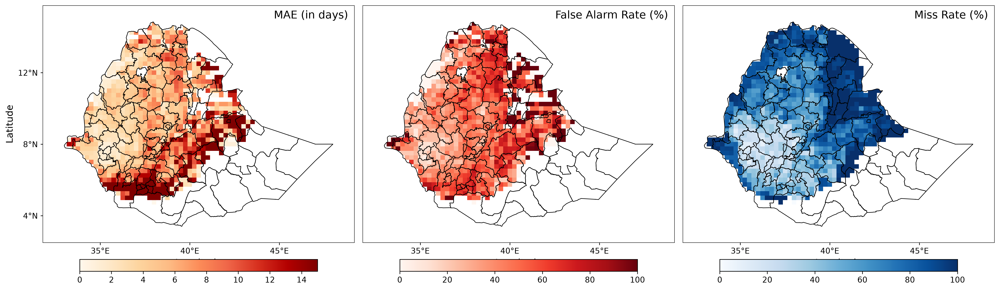

*Figure 2a. Days 1–15, CHIRPS 2000–2024. Mean MAE=9.061599 days; FAR=48.963000%; MR=74.197890%. Finite MAE/FAR cells: 1015; finite MR cells: 1346. All three spatial means are lower than the corresponding climatology means.*

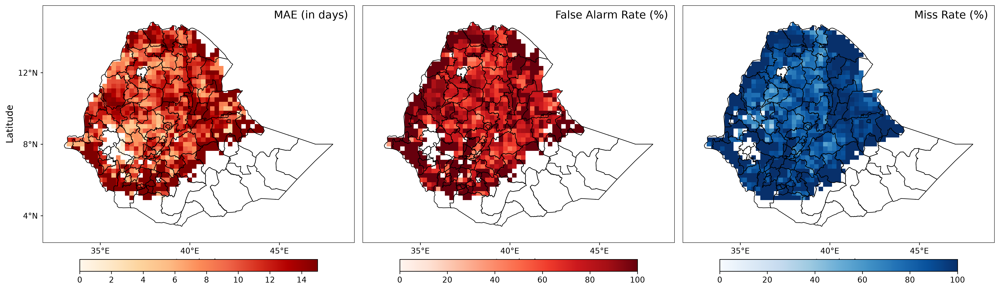

*Figure 2b. Days 16–30, CHIRPS 2000–2024. Mean MAE=14.228888 days; FAR=81.387526%; MR=90.978463%. Finite MAE/FAR cells: 974; finite MR cells: 1286. MAE remains slightly below climatology, but FAR and MR are higher.*


### FuXi Results

FuXi has a lower short-lead miss rate than AIFS Single but higher timing error and FAR. Its late-window MR is almost one; this does not mean its FAR is low.


*Figure 3a. Days 1–15, CHIRPS 2000–2024. Mean MAE=23.190556 days; FAR=81.508941%; MR=58.506954%. Finite MAE/FAR cells: 1651; finite MR cells: 1646. The corrected miss rate is substantial, not the historical near-zero result.*

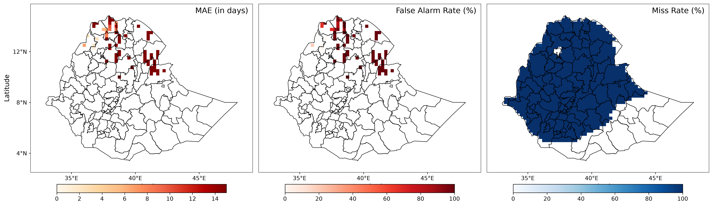

*Figure 3b. Days 16–30, CHIRPS 2000–2024. Mean MAE=38.568539 days; FAR=91.028514%; MR=99.973907%. Finite MAE/FAR cells: 156; finite MR cells: 1643. MAE/FAR describe a much smaller set of cells than MR; larger date errors saturate the MAE palette.*


### GraphCast Results

GraphCast and FuXi have very similar short-lead summaries here. Their small differences are not evidence of a significant ranking without uncertainty analysis; both trade lower MR against higher FAR than climatology in Days 1–15.

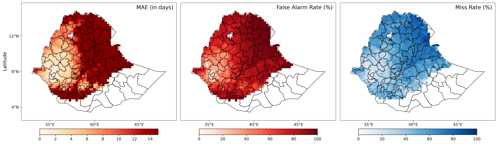

*Figure 4a. Days 1–15, CHIRPS 2000–2024. Mean MAE=23.242571 days; FAR=81.613620%; MR=58.694907%. Finite MAE/FAR cells: 1651; finite MR cells: 1646. Use the numerical summaries rather than inferring perfect detection from pale map colors.*

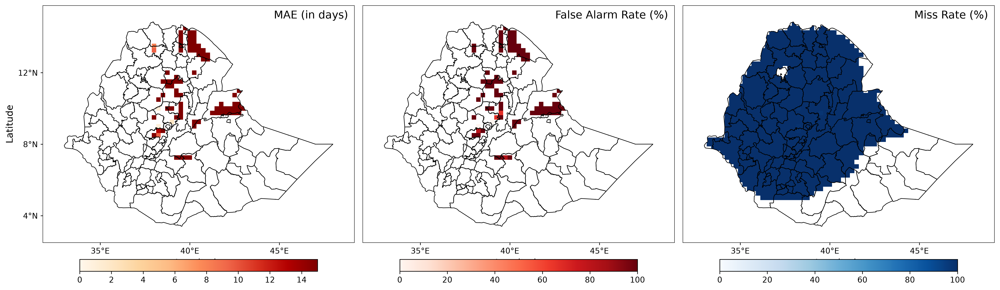

*Figure 4b. Days 16–30, CHIRPS 2000–2024. Mean MAE=52.604902 days; FAR=96.492754%; MR=99.993644%. Finite MAE/FAR cells: 115; finite MR cells: 1643. The mean date error exceeds the lead-window length because false alarms are compared with the actual observed onset date.*


### Climatology Reference Maps

The climatology reference uses the same observation source, configured mask and 2000–2024 period. It supplies separate verification-window metrics; a mean onset day-of-year map alone is not a reference MAE/FAR/MR map.

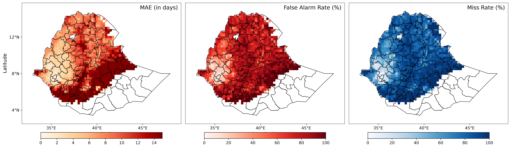

*Figure 5a. Climatology MAE, FAR and MR for Days 1–15; mean MAE is 14.617057 days. This is a direct MOMP output.*

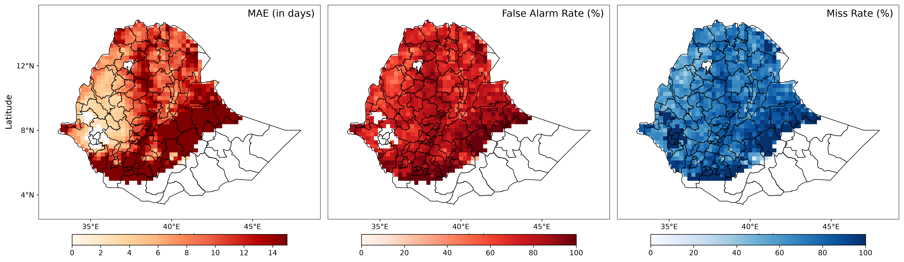

*Figure 5b. Climatology MAE, FAR and MR for Days 16–30; mean MAE is 14.534112 days. This is a direct MOMP output.*


### Deterministic Main Findings

- AIFS Single has lower mean MAE in both windows than the saved climatology reference. Its early-window FAR/MR also improve on the reference; late-window FAR/MR do not.
- FuXi and GraphCast have lower early-window MR than climatology, but higher mean MAE and FAR. Their late-window MR is almost one, with MAE/FAR available at far fewer cells.
- A date error can exceed the 15-day verification interval. A prediction on lead day 20 against an observed onset on day 100 is an 80-day false-alarm timing error.
- Grid coverage, finite-cell aggregation and source period are part of the result. These saved comparisons do not establish a universal model ranking.
- Figures and tables come from the same frozen artifacts; no ensemble MAE/MR/FAR ranking or arbitrary cross-metric composite is inferred.

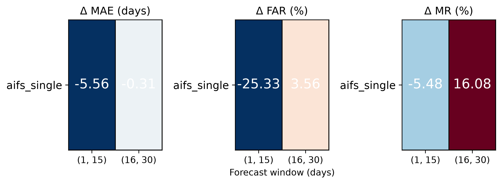

*Figure 6. The existing pipeline's AIFS Single portrait for both windows: model-minus-climatology differences of finite-cell means. Negative differences are lower error; positive differences are higher error. FAR/MR differences are percentage points. The runner also produces separate FuXi and GraphCast portraits in `data/ROMP_OUTPUT/figures/climatology/`.*


### Model Skill Rankings from the Original Test Run (Reference: Climatology = 0.0)

These are derived relative skills, $1-\overline{M}_{model}/\overline{M}_{climatology}$, computed from the separate finite-cell spatial means in the summary CSV. They are not the mean of cell-by-cell skill, and different metrics have different coverage. Fractions are shown below; multiply by 100 for percentages. There is no supported overall composite ranking in this snapshot.

| Model | Window | MAE Skill | FAR Skill | MR Skill |
| --- | --- | --- | --- | --- |
| Climatology | Days 1–15 | 0.000000 | 0.000000 | 0.000000 |
| Climatology | Days 16–30 | 0.000000 | 0.000000 | 0.000000 |
| AIFS Single | Days 1–15 | 0.380067 | 0.340910 | 0.068834 |
| AIFS Single | Days 16–30 | 0.021001 | -0.045731 | -0.214645 |
| FuXi | Days 1–15 | -0.586541 | -0.097190 | 0.265752 |
| FuXi | Days 16–30 | -1.653656 | -0.169607 | -0.334742 |
| GraphCast | Days 1–15 | -0.590099 | -0.098599 | 0.263393 |
| GraphCast | Days 16–30 | -2.619409 | -0.239815 | -0.335006 |


## Probabilistic Evaluation (AIFS-ENS)

### Run Configuration

- **Command Executed**: `python run_momp.py --mode prob --model AIFS_ENS`, with the shared settings and probabilistic date overrides shown above
- **Model Evaluated**: AIFS Ensemble, all 25 available members; the GenCast comparison uses all 32 available members
- **Evaluation Mode**: probabilistic, uncalibrated; the active pipeline does not execute IDR
- **Observational Reference**: prepared CHIRPS rainfall; climatological onset years 2007–2024
- **Spatial Domain**: 49 × 61 candidate positions on the 0.25° grid; these are not 2,989 valid/independent scored points in every case
- **Verification Windows**: Days 1–15 and Days 16–30; three five-day score bins per window plus outside-window RPS categories


### Processing Summary

- **Requested Evaluation Period**: 2003–2023 (21 years); **reference period**: 2007–2024 (18 years)
- **Initialization Selection**: weekly Monday/Thursday dates anchored to calendar year 2024, May–July, intersected with each source file's actual dates
- **Forecast Cases Before Paired RPS Filtering**: 97,474 per model/window, from the saved retained-plus-excluded counters; cases are initialization/grid-point combinations, not individual members
- **Paired RPS Cases Retained**: 78,498 for each model/window; 18,976 forecast cases and 220,073 reference cases are excluded as unsupported or unmatched
- **Sample Scope**: RPS/RPSS are calculated on matched cases with at least two effective members. BS/BSS/AUC use the pipeline's pooled bin summaries, so their sample scope is not asserted to be identical to paired RPS. Preserve these counters and the reference period when reproducing the comparison.


### Skill Scores: Verification Window (Days 1–15)

*(Lower is better for Fair Brier Score and Fair RPS; higher is better for skill fractions and AUC. Multiply skill fractions by 100 to compare with figure/dashboard percentages.)*

| Metric | AIFS-ENS Forecast | Climatology Reference | Skill Score |
| --- | --- | --- | --- |
| Fair Brier Score | 0.120640 | 0.077396 | BSS = -0.558746 |
| Fair RPS | 0.727660 | 0.486115 | RPSS = -0.496889 |
| AUC | 0.577447 | 0.844700 | – |

**Bin-wise Fair Brier Skill Score (BSS):**

| Bin | Fair BS (forecast) | Fair BS (climatology) | Fair BSS | AUC | AUC (climatology) |
| --- | --- | --- | --- | --- | --- |
| Days 1-5 | 0.103526 | 0.072357 | -0.430761 | 0.702694 | 0.875457 |
| Days 6-10 | 0.158740 | 0.081730 | -0.942249 | 0.529377 | 0.840761 |
| Days 11-15 | 0.099656 | 0.078100 | -0.275994 | 0.502984 | 0.816839 |

**Overall Fair BSS**: `-0.558746` | **Overall Fair RPSS**: `-0.496889`

All three AIFS Ensemble bins have negative BSS. Discrimination is strongest in Days 1–5 (AUC about 0.703) and approaches chance by Days 11–15. Negative BSS and AUC above 0.5 can coexist: probability error and ranking ability measure different properties.

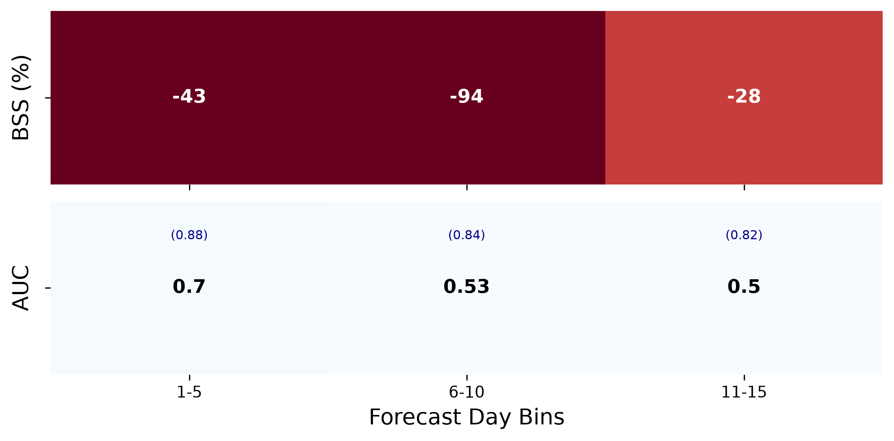

*Figure 7a. AIFS Ensemble, Days 1–15. Top row shows BSS percentages rounded to −43, −94 and −28; the lower row shows AUC with reference AUC in brackets. CSV/lesson table values retain more precision.*


### Skill Scores: Verification Window (Days 16–30)

*(Lower is better for Fair Brier Score and Fair RPS; higher is better for skill fractions and AUC. Multiply skill fractions by 100 to compare with figure/dashboard percentages.)*

| Metric | AIFS-ENS Forecast | Climatology Reference | Skill Score |
| --- | --- | --- | --- |
| Fair Brier Score | 0.062767 | 0.057991 | BSS = -0.082356 |
| Fair RPS | 1.572332 | 0.584653 | RPSS = -1.689344 |
| AUC | 0.501038 | 0.820828 | – |

**Bin-wise Fair Brier Skill Score (BSS):**

| Bin | Fair BS (forecast) | Fair BS (climatology) | Fair BSS | AUC | AUC (climatology) |
| --- | --- | --- | --- | --- | --- |
| Days 16-20 | 0.069946 | 0.066619 | -0.049931 | 0.502587 | 0.808754 |
| Days 21-25 | 0.061654 | 0.056191 | -0.097217 | 0.499988 | 0.820772 |
| Days 26-30 | 0.056702 | 0.051164 | -0.108254 | 0.499962 | 0.831087 |

**Overall Fair BSS**: `-0.082356` | **Overall Fair RPSS**: `-1.689344`

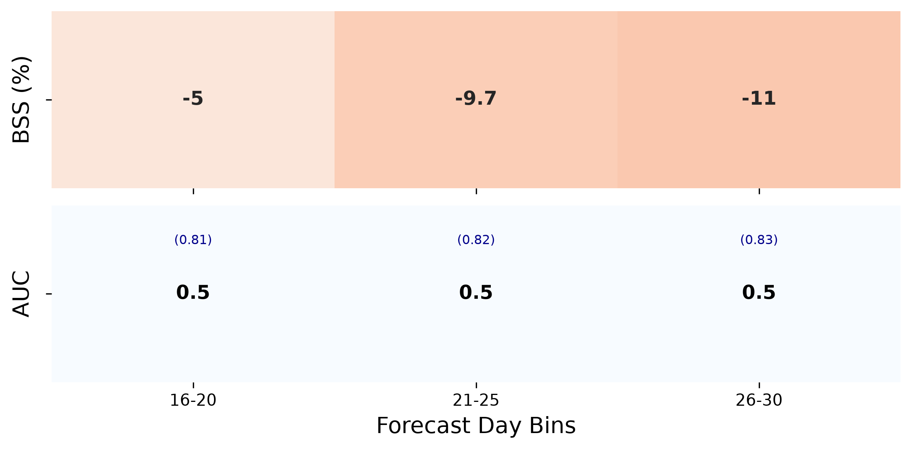

*Figure 7b. AIFS Ensemble, Days 16–30. The three BSS values remain negative (about −5%, −10% and −11%) and AUC stays close to 0.5. RPSS in the accompanying table is a whole-distribution score; this heatmap does not plot it per five-day bin.*

> #### Watch Out: Base-Rate Effect
> 
> Fair BS falls across the late bins, but relative BSS becomes more negative while AUC stays near 0.5. A smaller raw score alone does not prove greater skill: event frequency and the reference score also change. Read the exported forecast and reference BS together.
{: .warning}


### Data Files

The printed tables use the frozen lesson CSVs below, not mutable live outputs. Whole-window reference Fair BS is the mean of the three exported bin reference scores; reference Fair RPS is saved directly. Skill fractions and full-precision columns make the hand calculations reproducible.

| File | Contents |
| --- | --- |
| [binned_skill_scores_aifs_ens_1-15.csv](../data/demo4/aifs_ens/binned_skill_scores_aifs_ens_1-15.csv) | Five-day bins; aifs_ens, Days 1-15 |
| [binned_skill_scores_aifs_ens_16-30.csv](../data/demo4/aifs_ens/binned_skill_scores_aifs_ens_16-30.csv) | Five-day bins; aifs_ens, Days 16-30 |
| [overall_skill_scores_aifs_ens_1-15.csv](../data/demo4/aifs_ens/overall_skill_scores_aifs_ens_1-15.csv) | Whole-window scores, paired-RPS counts and scoring provenance; aifs_ens, Days 1-15 |
| [overall_skill_scores_aifs_ens_16-30.csv](../data/demo4/aifs_ens/overall_skill_scores_aifs_ens_16-30.csv) | Whole-window scores, paired-RPS counts and scoring provenance; aifs_ens, Days 16-30 |
| [binned_skill_scores_gencast_1-15.csv](../data/demo4/gencast/binned_skill_scores_gencast_1-15.csv) | Five-day bins; gencast, Days 1-15 |
| [binned_skill_scores_gencast_16-30.csv](../data/demo4/gencast/binned_skill_scores_gencast_16-30.csv) | Five-day bins; gencast, Days 16-30 |
| [overall_skill_scores_gencast_1-15.csv](../data/demo4/gencast/overall_skill_scores_gencast_1-15.csv) | Whole-window scores, paired-RPS counts and scoring provenance; gencast, Days 1-15 |
| [overall_skill_scores_gencast_16-30.csv](../data/demo4/gencast/overall_skill_scores_gencast_16-30.csv) | Whole-window scores, paired-RPS counts and scoring provenance; gencast, Days 16-30 |

Run the following calculation example from the repository root or a notebook inside it. It reads the saved CSVs and checks the displayed BSS/RPSS identities; benchmark computation itself uses `run_momp.py` or the existing dashboard.

```python
from pathlib import Path
import pandas as pd

root = Path.cwd()
while not (root / "run_momp.py").is_file():
    if root == root.parent:
        raise FileNotFoundError("Run this example inside the training repository")
    root = root.parent
bundle = root / "docs/data/demo4"
binned = pd.concat([
    pd.read_csv(bundle / "aifs_ens/binned_skill_scores_aifs_ens_1-15.csv"),
    pd.read_csv(bundle / "aifs_ens/binned_skill_scores_aifs_ens_16-30.csv"),
], ignore_index=True)
binned["BSS_check"] = 1 - binned["Fair_Brier_Score_Forecast"] / binned["Fair_Brier_Score_Climatology"]
assert (binned["BSS_check"] - binned["Fair_Brier_Skill_Score"]).abs().max() < 1e-10
print(binned[["Bin", "Fair_Brier_Skill_Score", "AUC", "AUC_ref"]])
for window in ("1-15", "16-30"):
    row = pd.read_csv(bundle / f"aifs_ens/overall_skill_scores_aifs_ens_{window}.csv").iloc[0]
    assert abs((1 - row.Fair_RPS / row.Reference_Fair_RPS) - row.Fair_RPS_Skill_Score) < 1e-10
    print(window, "RPSS (%)", 100 * row.Fair_RPS_Skill_Score, "matched cases", row.RPS_N_Forecasts)
```


### Reliability Analysis

A reliability diagram compares mean forecast probability (x) with observed event frequency (y). The dashed diagonal is perfect reliability. Grey bars are the **fraction of forecasts** in each probability bin on a logarithmic right axis; they are not raw case counts. Error bars are the implementation's binomial **one-standard-error** bars, not 95% confidence intervals or a spatial/temporal resampling analysis. Each figure verifies one full-window event, not a pool of its five-day bins.

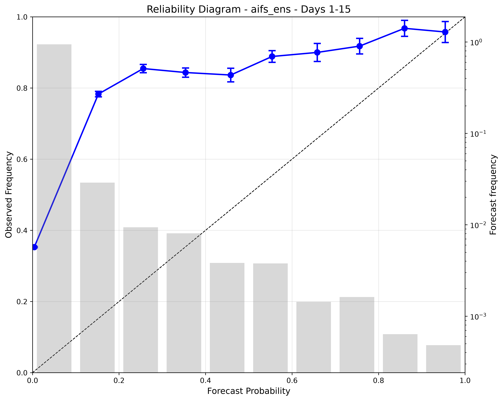

*Figure 8a. AIFS Ensemble reliability for onset in Days 1–15. The low- and middle-probability points lie above the diagonal: those probabilities understate observed frequency. The highest-probability point is slightly below the diagonal. This is not evidence of uniform overconfidence at every probability.*

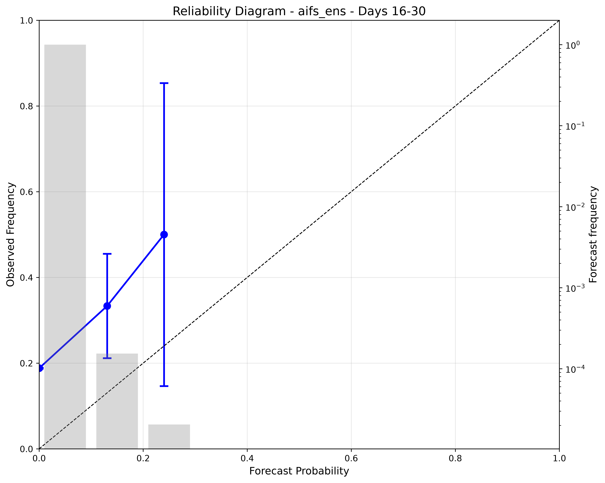

*Figure 8b. AIFS Ensemble reliability for onset in Days 16–30. Forecast frequency is concentrated in the lowest bin; the two higher populated points have much larger error bars. Their apparent trend does not establish useful discrimination: overall AUC is about 0.501.*

| Window | Verified event | Forecast-probability bin | Figure-supported diagnostic | Exact bin counts |
| --- | --- | --- | --- | --- |
| 1–15 Days | Onset anywhere in Days 1–15 | 0.0–0.1 | Dominant bin; observed frequency is above the forecast probability | Not exported in the saved CSVs |
| 16–30 Days | Onset anywhere in Days 16–30 | 0.0–0.1 | Dominant bin; higher-probability points have low frequency and wide error bars | Not exported in the saved CSVs |

> #### Interpretation
> 
> Read direction relative to the diagonal at each point. Above means the event occurred more often than predicted; below means less often. The old lesson's exact reliability counts were not supported by these artifacts. The snapshot contains the PNGs but no reliability-bin CSV, so use qualitative readings here and retain the printed reliability log or export the returned diagnostic table in a new experiment if exact counts are required.
{: .tip}

> #### Check the Figure
> 
> Confirm that Figures 8a and 8b name the full event windows. Explain why their observed frequencies cannot be substituted for a five-day AUC/BS row in Figure 7. Identify the axes and error-bar definition before reading numbers from the curves.
{: .tip}


### Key Takeaways & Next Steps

- **AIFS Ensemble Skill**: every saved five-day BSS is negative, and whole-window BSS/RPSS are negative in both windows. The previous positive first-bin BSS example does not apply to this snapshot.
- **Discrimination**: AIFS Ensemble's five-day AUC declines toward chance within Days 1–15 and remains close to chance in Days 16–30. GenCast has higher AUC in both windows, but that alone does not imply positive BSS.
- **Reliability and Calibration**: the curves motivate a held-out calibration experiment, not a claim that IDR has already improved these results. Save fitted-model versions, training/verification years and unchanged reference cases for any extension.


## Composite Metric Plots

Composite plots condense many runs into one figure so models, windows and metrics can be compared at a glance:

- **Portrait panel (Figure 6)**: the standard AIFS Single portrait generated by the runner. Equivalent model-specific portraits are produced for FuXi and GraphCast; the skill table lists all three models. FAR/MR use percentage-point differences. The skill table uses ratios of those same means, so the improvement signs are opposite.
- **Skill heatmaps (Figure 7)**: BSS and AUC per 5-day lead bin for probabilistic models.
- **Extension**: the same layout can be repeated across wet-spell thresholds, dry-spell thresholds or regions, which is how the package supports the goal of comparing models across location, thresholds and lead time.

> #### Reading Composite Plots
> 
> Compare each portrait entry with the summary CSV and the corresponding map. Figure 6 has no cross-metric average or ensemble error ranking. A smaller MAE can cover fewer cells; finite-cell counts are part of the interpretation.
{: .tip}

## Preliminary Model Results

The supported comparison here is GenCast versus AIFS Ensemble on the frozen prepared 0.25° inputs. It uses the same probabilistic evaluation/reference periods recorded above; it is separate from the deterministic 2000–2024 results. The [GenCast summaries](../data/demo4/gencast/overall_skill_scores_gencast_1-15.csv) provide the numbers below. These are uncrossvalidated reference comparisons, not evidence for a resolution benefit or an operational ranking.


### 0.25° Resolution

GenCast has higher AUC than AIFS Ensemble in both windows. Its early RPSS is positive while BSS is negative; this is possible because the scores use different event/distribution definitions and sample aggregation. Both late-window skill fractions are negative.

| Window | AUC | BSS | RPSS |
| --- | --- | --- | --- |
| Days 1–15 | 0.783308 | -22.301442% | 10.345233% |
| Days 16–30 | 0.624291 | -2.972453% | -36.399486% |

Compare these percentages with the AIFS Ensemble tables after multiplying their skill fractions by 100. GenCast's first late five-day bin has slightly positive BSS, but its whole-window late BSS is negative; a bin and a whole window are different summaries.


### 1° Resolution

No 1° benchmark, source grids or result tables are included in this snapshot. The previous numerical resolution comparison could not be traced to saved artifacts and has been removed. Treat 1° evaluation as a proposed extension: regrid rainfall consistently, redetect onset, recompute probabilities/reference scores and document the new sample size.

| Window | AUC | BSS | RPSS |
| --- | --- | --- | --- |
| Days 1–15 | Not computed | Not computed | Not computed |
| Days 16–30 | Not computed | Not computed | Not computed |

Neither a larger nor a smaller skill value at coarser resolution can be inferred from the available 0.25° results.


### Discussion Questions

1. What would have to be held fixed, and what would change, in a fair 1° extension? Separate regridding daily rain from averaging already-derived onset scores.
2. Why can GenCast have positive early RPSS but negative BSS? Check the event categories, reference definitions and saved sample counters before proposing a physical explanation.
3. Which error metrics are actually produced for each track? Explain why ensemble discrimination cannot be described as a deterministic miss rate from these saved probability summaries.


## Best Practices and Troubleshooting

### Best Practices for Defensible Benchmarks

| Concept | Why it matters |
| --- | --- |
| Same onset definition everywhere | Record shared parameters and any lead-dependent truncation; a changed definition requires a new comparison. |
| Threshold sensitivity | Changing wet/dry thresholds can change ranking. Test several. |
| Lead time and initialization dates | Skill depends on when the forecast starts relative to onset. |
| Matching tolerance | A larger tolerance raises hits and hides timing error. Report it with every result. |
| Reference choice | Climatology, persistence or another model give different skill scores. |
| Base rate | Event frequency, reference error and forecast quality jointly affect BSS; a lower raw BS is not sufficient evidence of improved skill. |
| Resolution and sample size | Recompute onset and reference scores when resolution changes; no direction of skill change is established here. |
| Spatial aggregation | Grid-cell metrics differ from regional or national averages. |
| Calibration and blending | Test post-processing on held-out years with unchanged verification cases; no IDR/EMOS result is provided here. |
| Separate DET and PROB tracks | Use mode-specific workers and interpret each saved metric family against its own reference. |
| Reproducibility | Keep the config file, package version and data versions with every result. |

### Reporting Checklist

Every benchmark result should state:

- [ ] Onset definition parameters (`wet_init`, `wet_spell`, `wet_threshold`, `dry_spell`, `dry_threshold`, `dry_extent`, search window)
- [ ] Verification dataset and its resolution
- [ ] Model, requested and retained evaluation cases, initialization schedule/calendar and available member counts
- [ ] Lead-time windows and matching tolerance
- [ ] Reference used for skill (and its period)
- [ ] Track (`DET` or `PROB`), and whether forecasts were calibrated
- [ ] Repository revision, configuration/dashboard settings, environment overrides and any missing/undefined metrics

### Troubleshooting Common Failure Modes

| Symptom | Likely cause | What to check |
| --- | --- | --- |
| Run stops or results look meaningless after switching tracks | Wrong mode, stale settings or incompatible model selection | Check `run_momp.py --help`, the actual command and the existing dashboard/configuration settings |
| Model is missing from the output | Unregistered model, missing source years or unmatched initialization dates | Catalog key, prepared input filenames and initialization coverage |
| Blank cells or N/A | Masked cells, absent predictions/observations or a zero/nonfinite denominator | Metric-specific finite counts, actual coverage and saved reference scores; missing does not mean zero |
| Very high miss rate despite predicted events | Forecast dates miss the timing tolerance, or events occur outside the interval | Check both date errors and the corrected FP/FN counting definition |
| MAE exceeds 15 or 30 days | False-alarm date errors compare with observed onset outside the selected interval | Read `mae_combined` semantics and the color cap before treating it as an error |
| Grid, boundary or unit problems | Different prepared inputs, source metadata or mask | Configured CHIRPS grid, `ETH_Zones.geojson`, mask and precipitation conversion logs |
| RPSS is N/A | Old CSV, unsupported reference members, missing matched cases or zero reference RPS | `Score_Definition`, `Reference_Fair_RPS`, `RPS_N_Forecasts` and excluded-case counters |
| Skill changes after a rerun | Evaluation/reference periods or retained sample sets differ | Compare evaluation/reference years, score definitions and retained-case counters in the saved CSVs |
| SciPy `_spropack` import failure | Worker inherited a broken scientific environment | `.venv/bin/python` on the host or `ROMP_PYTHON=/opt/envs/app/bin/python` in this image; verify the dependency-check output |
| Dashboard still shows old values | Cached result metadata or files from an earlier run | Use **Refresh saved results**; distinguish live `data/ROMP_OUTPUT/` from the frozen lesson bundle |


## Exercises

Use the **Forecast Benchmarking** dashboard for every exercise. Work in pairs and change one setting at a time, comparing each result with your recorded baseline. The timings allow **40 minutes of hands-on activity**; computation time is additional. The facilitator can demonstrate or share a completed run while groups wait.

Use a short practice period: **Evaluation Start = 1 May 2020**, **Evaluation End = 31 July 2020**, **Baseline Start Year = 2018** and **Baseline End Year = 2021**, if those years are available. Otherwise, the facilitator should choose one available evaluation year and a common baseline period of at least two available years that includes it. These practice runs use fewer years than the lesson figures, so their numbers will differ. Record the model, changed setting, lead window, and before/after scores on paper or in a screenshot before starting the next run; a rerun replaces that model's saved results. Record N/A as unavailable, not zero.

> #### Exercise 1: Set Up a Baseline in the Dashboard (5 min)
>
> 1. Choose **Ground truth → CHIRPS**, **Benchmark coverage → Ethiopia** and **Filter by category → Deterministic**. Select only **AIFS Single** in the model table. Open **Parameter guide** to read the explanations of the controls.
> 2. In **Model run windows**, enter the practice dates and baseline years above. Set **Wet-day threshold = 20**, **Minimum wet-day rainfall = 1**, **Wet spell length = 3**, **Dry spell limit = 7** and **Dry spell search extension = 21**. Keep **Area mask file** at the facilitator's configured JJAS mask; leave any existing path unchanged. Choose **Onset threshold file → Dataset default** and **Baseline forecast → climatology**. The control labelled *Wet-day threshold* is the **total rainfall required over the wet spell**, not 20 mm on each day.
> 3. Under **Advanced Temporal & Verification Settings**, expand AIFS Single. Choose **Initialization schedule → Weekly**, **Initialization weekdays → Monday and Thursday**, **Reference calendar year = 2024**, **Verification windows → Days 1–15** and **Tolerance: days 1–15 = 3**. Leave **Max Forecast Day (automatic)** unchanged. Click **Run Benchmark** and wait for the completion message. In **All Metrics**, choose **Metric model category → All**, untick **All models**, select **AIFS Single** and **Traditional Climatology** in **Models to compare**, and choose **Lead times → Days 1–15**. Record MAE, miss rate and false-alarm rate as your baseline. If Run is disabled, read the availability message and ask the facilitator to check the selected dates.
{: .exercise}


> #### Exercise 2: Change the Rainfall Threshold (5 min)
>
> 1. Starting from Exercise 1, change only **Wet-day threshold** from **20 to 30**. Keep the model, dates, mask, wet-spell length and all other settings unchanged. Predict whether it will become easier or harder for a wet spell to qualify as onset.
> 2. Click **Run Benchmark**. After completion, return to the same **All Metrics** selection and record the new MAE, miss rate and false-alarm rate. In **Metric Map**, keep the same **Model**, **Lead Time** and **Metric** when comparing your screenshots.
> 3. Which scores changed, and in which direction? Did a higher threshold improve all three scores together? Remember that the changed onset definition applies to observations and the reference as well as the model. Return **Wet-day threshold** to **20** before the next exercise.
{: .exercise}


> #### Exercise 3: Allow a Larger Timing Error (5 min)
>
> 1. Restore the baseline settings from Exercise 1, then change only **Tolerance: days 1–15** from **3 to 5**. Keep **Verification windows → Days 1–15**. Predict what happens when an onset prediction is allowed to be a few more days away from the observed date.
> 2. Click **Run Benchmark** and compare the new miss rate, false-alarm rate and MAE with your Exercise 1 notes. Did either event-error rate fall or stay the same? Did MAE change?
> 3. Discuss why accepting a larger timing error can improve the event scores without changing the rainfall forecast. Scores may stay the same when no cases fall near the changed tolerance boundary. Return the tolerance to **3** afterwards.
{: .exercise}


> #### Exercise 4: Switch Off the Dry-Spell Check (10 min)
>
> 1. Restore the baseline settings from Exercise 1. Change only **Dry spell search extension** from **21 to 0**; leave **Dry spell limit = 7**. A value of zero disables the check for a dry spell after a candidate onset. Predict whether an early wet spell followed by dry weather can now be accepted.
> 2. Click **Run Benchmark**. Compare the three scores in **All Metrics** with your original baseline. In **Metric Map**, choose AIFS Single and Days 1–15, then look at **Miss Rate**, **False Alarm Rate** and **Mean Absolute Error** in turn. Use the same map area as before.
> 3. Describe one change you see. Would removing this check be a sensible way to advise a farmer when to plant, even if one score improves? Explain why a different onset definition does not by itself make the weather model better. Restore **Dry spell search extension = 21** afterwards.
{: .exercise}

<details markdown="1">
<summary><strong>Check your answer</strong></summary>
<br>

> #### Solution
>
> With the dry-spell check disabled, an early wet spell can qualify as onset even when dry weather follows it. This can change onset dates in the model, observations and climatology. The three scores can respond differently, so there is no single numerical answer for every practice period. An improved score after changing the definition does not show that the rainfall forecast improved. Use your recorded before/after results, and consider the risk of a false planting signal as well as the scores.
{: .solution}

</details>


> #### Exercise 5: Change the Reference for an Ensemble (5 min)
>
> 1. Restore the shared wet/dry settings from Exercise 1. Set **Filter by category → Probabilistic**, select only **AIFS Ensemble**, and check the model-selection summary. Set its practice evaluation dates and baseline years to the same values used in Exercise 1. Under its advanced settings, keep the same weekly schedule and **Verification windows → Days 1–15**. Click **Run Benchmark**. In **All Metrics**, choose **Metric model category → Probabilistic**, untick **All models**, select AIFS Ensemble in **Models to compare**, and choose **Lead times → Days 1–15**. Record **AUC**, **Fair Brier Skill Score (%)** and **Fair RPS Skill Score (%)**.
> 2. Change only **Baseline Start Year** from **2018 to 2010**, if those observation years are available; otherwise use an earlier available year suggested by the facilitator. Keep **Baseline End Year = 2021** and the evaluation year unchanged. The baseline must still include the evaluation year. Run the benchmark again and compare the same three displayed scores.
> 3. Did the skill scores against climatology change? The weather-model rainfall forecasts are the same, but the historical comparison and the number of usable comparisons can change. In **Benchmark Outputs**, use **Figure Type → Reliability Diagram** to inspect the Days 1–15 figure. Is the curve above or below the diagonal at low probabilities? Report what your own run shows. Restore the original baseline years afterwards.
{: .exercise}


> #### Exercise 6: Compare Lead Windows and Share a Finding (5 min)
>
> 1. Select only **AIFS Single** again and restore the shared settings, evaluation dates and baseline years from Exercise 1. Under its advanced settings, change **Verification windows** to **Both windows**. Set **Tolerance: days 1–15 = 3** and **Tolerance: days 16–30 = 3**, keeping the same allowed timing error for this comparison. Notice that **Max Forecast Day (automatic)** updates to 30; leave it unchanged. Click **Run Benchmark**.
> 2. In **All Metrics**, choose **Metric model category → All**, untick **All models**, select AIFS Single and Traditional Climatology in **Models to compare**, then choose both **Lead times**. Compare MAE, miss rate and false-alarm rate across the two windows from this completed run. In **Metric Map**, switch **Lead Time** while keeping the model, metric and map area fixed. These practice tolerances differ from the lesson's standard 3/5-day setup, so use your displayed results rather than the printed reference numbers.
> 3. Share one finding with another pair: state the setting you changed, the scores you observed and one limitation. Did a setting improve one score while worsening another? Explain why a longer lead window or a looser onset rule should not automatically be described as a better forecast.
{: .exercise}

### Wrap-up Discussion

Ask each pair to identify one conclusion supported by a saved artifact, one hypothesis requiring a new experiment, and one metadata field needed to distinguish them.

## Summary

> #### Key Points
>
> - Onset is derived from daily rainfall. Record wet-spell totals, daily cutoffs and the effective dry-search extent; forecast lead truncation matters.
> - ROMP is configuration-driven, so results can be reproduced and compared across location, thresholds, lead time and models.
> - Deterministic (FAR, MR, MAE) and probabilistic (BS, RPS, AUC, reliability) tracks are separate and their metrics cannot be compared directly.
> - Skill is metric- and reference-specific. AIFS Single improves on the deterministic reference for early MAE/FAR/MR, while GenCast has positive early RPSS but negative BSS in this probability snapshot.
> - Read metrics together: FAR with MR and MAE, and BSS with AUC and reliability.
> - The saved probability results are uncalibrated. A calibration or 1° extension needs new implementation/data processing and held-out verification before any improvement can be claimed.
> - Resolution, period, tolerance and sample size all affect scores. Document them with every result.
{: .keypoints}


