## Objectives

By the end of this session, participants will be able to:

1. **Run and inspect** a benchmark through the **Benchmarking dashboard** (click **Benchmarking** in the top menu); use the CLI as an optional alternative.
2. **Explain** why ROMP/MOMP compares onset across locations, thresholds, lead times and models.
3. **Describe** the rainfall-based onset rules and their forecast-horizon limitations.
4. **Interpret** deterministic and probabilistic metrics against their appropriate references.
5. **Read** saved maps, composite plots and reliability diagrams without confusing missing values with skill.
6. **Document** an experiment and distinguish supported findings from extensions needing held-out verification.

---

## Monsoon Onset Parameters

Moonson onset matters for planting decisions. It is **derived from daily rainfall**, not read directly from model output.

| Parameter | Reference setting | Meaning |
|:---|:---|:---|
| `wet_init` | ≥1 mm/day | Minimum rainfall on **each** wet day |
| `wet_spell` | 3 days | Consecutive wet days required |
| `wet_threshold` | Total **>20 mm** | Strict accumulation threshold over the **whole wet spell** |
| `dry_spell` | 7 days | Consecutive dry days that can reject a candidate |
| `dry_extent` | 0 by default; 21 in the historical snapshot | Full confirmation interval including the candidate day; 0 disables it |

::: {.callout-important}
The dashboard's **Wet-day threshold** is a wet-spell **total**, not 20 mm on each day. `dry_threshold=1` is the independent dry-day cutoff. The reference default `dry_extent=0` disables dry confirmation; enabling it changes the onset definition.
:::


## Dashboard Walkthrough: Hands-On 

Click **Benchmarking** in the top menu and follow the page from top to bottom:

1. **Benchmark Inputs** and **Models** → choose the data and model track.
2. **Shared settings**, **Model run windows**, **Advanced Temporal & Verification Settings** → define the experiment.
3. **Data Readiness & Fair Comparison** → resolve availability problems before running.
4. **Run Benchmark** → monitor, stop if necessary, and inspect the execution log.
5. **Results** → compare maps and metrics, inspect saved figures, and retain evidence.

::: {.callout-note}
These instructions follow the implemented [Benchmarking page](../../ui/pages/short_medium_benchmarking.py). The dashboard is the primary workflow; the **CLI section later is optional**.
:::

---

## Open the Benchmarking Dashboard

1. Complete **Demo 1**; start the stack from the repository root:

   ```bash
   cd training-program-2026
   bash docker/run.sh start
   ```

2. For a remote server, keep a separate laptop terminal open:

   ```bash
   ssh -L 8503:localhost:8503 <you>@country-spark
   ```

3. Open **<http://localhost:8503>** and confirm the page title **Benchmarking**.
4. Open **Parameter guide** for control explanations. The top tiles show **Models**, **Presets**, **Status** and **Output Dir**.


::: {.smaller}
Benchmark scoring uses CPUs and saved forecasts. Confirm that the container's `/app` checkout and configured input data belong to this experiment.
:::

---

## Step 1: Inputs and Model Selection

| Control | Classroom selection / action |
|:---|:---|
| **Ground truth** | Choose **CHIRPS**; ENACTS requires matching configured data |
| **Benchmark coverage** | Choose **Ethiopia**; unsupported coverage disables Run |
| **Forecast window** | Start with **1-15 days**; check each model's verification controls below |
| **Filter by category** | Choose **Deterministic** for the first run |
| **Models table** | Click only the **AIFS Single** row; check Category, Coverage and Date Range |

- The table supports multiple selected rows; the selection summary counts deterministic, probabilistic and total models.
- For the ensemble exercise, switch to **Probabilistic** and select **AIFS Ensemble**.
- Run the lesson tracks separately and read their different metric families independently.

---

## Step 2: Shared Event Detection

Under **Shared settings → EVENT DETECTION**, use the lesson baseline:

| Exact dashboard control | Value | Meaning |
|:---|---:|:---|
| **Wet-day threshold** | 20 | Strict total-rainfall threshold over the wet spell, in mm |
| **Minimum wet-day rainfall** | 1 | Minimum daily rainfall, in mm |
| **Wet spell length** | 3 | Consecutive wet days |
| **Dry spell limit** | 7 | Consecutive dry days needed for a veto |
| **Dry spell search extension** | 21 | Requested follow-up search, in days |

::: {.callout-important}
These settings apply to **every selected model** in the next run. This sensitivity baseline intentionally enables 21-day confirmation instead of the reference default of 0. Days 1–15 needs at least 35 forecast days with this criterion; the full interval is preserved. Use 0 to disable dry confirmation explicitly. Both windows with 21-day confirmation need data through day 50.
:::

---

## Step 3: Masks, Thresholds and Reference

Under **MASKS AND BASELINE**:

1. **Area mask file:** keep the facilitator's configured mask. Choices include **JJAS 100mm rainfall mask**, **JJAS seasonal 0.25 mask**, **No mask** and **Custom path**.
2. If using **Custom path**, enter **Area mask file path**. For the lesson JJAS mask, True/1 means keep.
3. **Onset threshold file → Dataset default** for the baseline. A reference CSV or custom path is a separate documented experiment.
4. **Baseline forecast → climatology**. Use a custom baseline name only when that reference is configured.

::: {.callout-tip}
Keep mask, reference and onset definition fixed during model comparisons. Save their selections with the scores; changing them changes the evaluated experiment.
:::

---

## Step 4: Model Run Windows

Expand each selected model under **Model run windows**.

| Control | Practice setting, if available |
|:---|:---|
| **Evaluation Start** | **1 May 2020** |
| **Evaluation End** | **31 July 2020** |
| **Baseline Start Year** | **2018** |
| **Baseline End Year** | **2021** |

- Read the **Shared model/observation window** and each model's available dates before editing.
- The month/day range defines the initialization season repeated in each evaluation year.
- If the practice period is unavailable, use one available evaluation year and a baseline of at least two available years including it.

::: {.callout-note}
Repeat these settings for each selected model. Short practice runs differ from the multi-year saved figures; retain your own baseline scores.
:::

---

## Step 5: Initialization and Verification

Under **ADVANCED TEMPORAL & VERIFICATION SETTINGS**, expand the model:

| Control | Baseline selection |
|:---|:---|
| **Initialization schedule** | **Weekly** |
| **Initialization weekdays** | **Monday** and **Thursday** |
| **Reference calendar year** | **2024**; aligns weekdays, not evaluation years |
| **Verification windows** | **Days 1–15** to begin; **Both windows** for the lead comparison |
| **Tolerance: days 1–15** | **3** |
| **Tolerance: days 16–30** | **5** for the lesson reference; **3** in Exercise 6 |

::: {.smaller}
**Max Forecast Day (automatic)** becomes 15 or 30; leave it unchanged. **Daily** uses available dates; **Monthly** exposes **Initialization days of month**, skipping days absent from a month. These per-model settings apply to the next run.
:::

---

## Step 6: Check Readiness Before Running

1. If available, open **Data Readiness & Fair Comparison → Data Readiness Report**. Inspect **Ready**, **Warning**, **No data**, **Error**, and the input inventory.
2. Read all messages below the configuration controls. A disabled run can mean unsupported coverage, missing observation years, no matching initialization dates or insufficient forecast lead coverage.
3. Check that dates, baseline years, schedule, verification windows and tolerances define a valid comparison.
4. Resolve the reported issue with the facilitator; do not interpret an old saved result as the new experiment.

::: {.callout-note}
The readiness report is an optional module. The page also checks selected model/observation dates, initialization schedules and required forecast horizon before enabling the run.
:::

---

## Step 7: Run, Monitor and Stop

1. Click **Run Benchmark**. Selected model workers run one after another.
2. Read the live output panel. To cancel, click **Stop Benchmark** and wait for the cancellation status.
3. After completion or failure, expand **Latest benchmark execution log**; retain the actual command and output for every model.
4. Confirm the completion message. Changed-settings warnings mean existing files still describe an earlier run.
5. Click **Refresh saved results** after a completed or externally run benchmark when the display needs reloading.

::: {.callout-warning}
Cancelled runs may leave incomplete outputs; rerun to obtain a complete result. A shutdown-verification warning requires checking worker cleanup. The optional CLI is not needed for these dashboard actions.
:::

---

## Step 8: Read and Compare Metric Maps

Open **Results → Metric Map**. Select **Metric**, **Lead Time**, **Model**, then **Subregion level / Subregion** if boundaries are configured.

| Map sub-tab | What to do |
|:---|:---|
| **Values** | Read the metric map and comparison table; keep the same area across screenshots |
| **Skill** | Read the pass/fail classification against the metric's displayed threshold |
| **Difference** | Choose **Compare against model** and **Compare against lead time**; read selected minus comparison |
| **Swipe Compare** | Choose **Compare by → Model / Lead Time**, set the right-hand model/window, then **Drag to swipe** |

::: {.callout-important}
The **Skill** sub-tab is a threshold-status map, **not** the relative skill formula against climatology. For a controlled comparison, hold the metric and area fixed; do not compare a map with itself.
:::

---

## Step 9: All Metrics and Distributions

1. Open **Results → All Metrics** and choose **Metric model category**.
2. Untick **All models** to enable **Models to compare**. For the baseline, select **AIFS Single** and **Traditional Climatology**.
3. Set **Lead times → Days 1–15**, or both windows after a joint-window run.
4. Read the category-specific tables and **Detailed Metric Distributions**: Mean, Min, Median, P75, P90 and Max.
5. For the ensemble exercise, choose **Probabilistic** and record AUC, Fair Brier Skill Score (%) and Fair RPS Skill Score (%).

::: {.callout-tip}
Record model, window, settings and before/after values. Lower error and higher skill/discrimination have different directions; an unsupported or undefined entry is **N/A**, not zero.
:::

---

## Step 10: Figures, Downloads and NetCDF

Open **Results → Benchmark Outputs**:

1. Choose **Category**, then **Figure Type**, then **Select Figure**. For calibration diagnostics, select **Reliability Diagram**.
2. Use **Layout View → Grid / Full Width**; **Show All Figures in Selection** opens the selected collection, with **Figure page** when needed.
3. Use **Download** to retain a PNG, or **Zoom Modal → Download High-Res PNG** for full-resolution inspection.
4. Tick **Load NetCDF Data Explorer**, then select **Dataset** and **Variable** to inspect the saved arrays.

::: {.callout-note}
These assets come from `data/ROMP_OUTPUT/` and its `figures/` subfolders. Save the source dataset and configuration with the image; a later rerun can overwrite the model's outputs.
:::

---

## Dashboard Extensions: Location, Skill and Uncertainty

These tabs appear **only when their supporting modules are available**.

| Optional tab | Dashboard action | Interpretation |
|:---|:---|:---|
| **Onset Analysis** | Set **Year**; choose **Location Selection Mode → Coordinates / Woreda**; enter latitude/longitude or filter/select a woreda; click **Run Onset Analysis** | Check the reported snapped grid coordinates and onset time-series figures |
| **Skill vs Baseline** | Open the tab after a completed benchmark | Read available verification scores relative to climatology |
| **Uncertainty** | Click **Compute Uncertainty**; inspect Metric Uncertainty and Significance vs Baseline | Record the method and sample support before claiming significance |

::: {.callout-warning}
Available dashboard diagnostics are not evidence that the saved benchmark results are statistically significant. The lesson's reliability bars are **one standard error**, not bootstrap 95% intervals.
:::

---

## Step 11: Export a Benchmark Report

If **Benchmark Report & Export** is available:

1. Inspect **Provenance Metadata**, when provided by the installed modules.
2. Check **Report Summary**: Models Evaluated, Ground Truth, Forecast Window and Baseline.
3. Click **Generate Complete PDF Report**, wait for the success message, then **Download Complete PDF Report**.
4. Preserve the PDF with the saved PNGs, source datasets, settings and execution log.

::: {.callout-important}
A generated report packages the outputs available at generation time. Confirm that those files match the selected experiment; exporting does not recompute a benchmark. If PDF support is unavailable, retain the lesson's paper/screenshot scorecard instead.
:::

---

## Dashboard Workflow Checkpoint

Before moving to the lesson figures and exercises, demonstrate that you can:

- Select **AIFS Single**, CHIRPS/Ethiopia and an available practice period.
- Set the shared onset rules and per-model weekly schedule/window/tolerance.
- Explain a readiness message, start a run, locate **Stop Benchmark** and open the execution log.
- Compare AIFS Single with **Traditional Climatology** in **All Metrics**.
- Find a saved PNG, inspect its source NetCDF and retain the result before the next run.

::: {.callout-question}
Which setting will you change in the next experiment, which controls will stay fixed, and where will you record the comparison?
:::

---


# Worksheet for AI Weather Model Benchmarking

## Six Dashboard Exercises: 15 Minutes

Work in pairs; change **one setting at a time** and restore the baseline between experiments. Computation time is additional; use a facilitator's completed run while waiting.

| Exercise | Minutes | Change / question |
|:---|---:|:---|
| 1. Establish a baseline | 5 | AIFS Single, Days 1–15 |
| 2. Rainfall threshold | 5 | Wet-spell total: 20 → 30 mm |
| 3. Timing tolerance | 5 | Days 1–15: 3 → 5 days |
| 4. Dry-spell check | 10 | Search extension: 21 → 0 days |
| 5. Ensemble reference | 5 | Baseline start: 2018 → 2010, if available |
| 6. Lead windows and a finding | 5 | Both windows with equal 3-day tolerances |

::: {.smaller}
Practice: evaluation **1 May–31 July 2020**; baseline **2018–2021**, or the facilitator's available equivalent including the evaluation year.
:::

---

## Exercise 1: Establish the Baseline (5 min)

1. Apply the dashboard baseline and advanced settings just shown; select only **AIFS Single** and run **Days 1–15**, tolerance **3 days**.
2. In **All Metrics**, choose **Metric model category → All**, untick **All models**, select **AIFS Single** and **Traditional Climatology** in **Models to compare**.
3. Choose **Lead times → Days 1–15** and retain the scores and settings before the next run.

| Metric | AIFS Single | Traditional Climatology |
|:---|:---:|:---:|
| MAE (days) | | |
| Miss rate (%) | | |
| False-alarm ratio (%) | | |

::: {.callout-question}
Which observation years, initializations and reference settings did this run actually use? Record unavailable values as N/A.
:::

---

## Exercise 2: Raise the Rainfall Threshold (5 min)

1. Starting from Exercise 1, change only **Wet-day threshold: 20 → 30**; keep dates, mask, wet-spell length and all other settings fixed.
2. Predict how qualification as onset changes, then **Run Benchmark**.
3. Record MAE, MR and FAR in the same **All Metrics** selection; compare identical **Metric Map** views or screenshots.
4. Did all three scores improve together? Restore the threshold to **20**.

::: {.callout-important}
This changes the **wet-spell total** used for observations, model and reference. A changed event definition is not evidence that the rainfall forecast itself improved.
:::

---


## Exercise 3: Switch Off the Dry Check (5 min)

1. Restore the baseline; change only **Dry spell search extension: 21 → 0**. Keep **Dry spell limit = 7**.
2. Predict whether an early wet spell followed by dry weather can qualify; rerun.
3. Compare MAE, MR and FAR in **All Metrics** and each **Metric Map**, keeping the same model, window and area.
4. Would this definition be appropriate for planting advice, even if one score improves? Restore the extension to **21**.

::: {.fragment}
**Check your answer:** zero disables the follow-up veto. Onset dates can change in forecasts, observations and climatology. There is no universal numerical answer: use the recorded before/after results and discuss false planting signals.
:::

---


## Reflection: Read Metrics Together

::: {.callout-question}
What happens if a model never predicts onset? What if it always predicts onset, but often at the wrong time?
:::

::: {.fragment}
- **Never predicts:** all observed events are missed; FAR is **undefined**, because there are no event forecasts.
- **Always predicts:** timing outside tolerance can still cause misses as well as false alarms.
- MAE includes known timing errors on false alarms; a smaller MAE may cover fewer cells.
:::

::: {.callout-tip}
Share **one artifact-supported conclusion**, **one hypothesis needing a new experiment**, and **one metadata field** needed to distinguish them.
:::

---


# Benchmark Concepts and Saved Results

## Monsoon Onset Parameters

Kiremt onset matters for planting decisions. It is **derived from daily rainfall**, not read directly from model output.

| Parameter | Reference setting | Meaning |
|:---|:---|:---|
| `wet_init` | ≥1 mm/day | Minimum rainfall on **each** wet day |
| `wet_spell` | 3 days | Consecutive wet days required |
| `wet_threshold` | Total **>20 mm** | Strict accumulation threshold over the **whole wet spell** |
| `dry_spell` | 7 days | Consecutive dry days that can reject a candidate |
| `dry_extent` | 0 by default; 21 in the historical snapshot | Full confirmation interval including the candidate day; 0 disables it |

::: {.callout-important}
The dashboard's **Wet-day threshold** is a wet-spell **total**, not 20 mm on each day. `dry_threshold=1` is the independent dry-day cutoff. The reference default `dry_extent=0` disables dry confirmation; enabling it changes the onset definition.
:::

---

## Shared Rules, Finite Forecast Horizons

- Initializations cover **May–July**; observed detection starts with `mok=(5,15)` and extends the seasonal end by **47 days**.
- The current forecast confirmation interval includes the candidate day and is never shortened automatically. Insufficient lead coverage blocks the run.
- With a 3-day wet spell, verifying through day 30 needs day 32 with dry confirmation disabled, or day 50 with a full 21-day interval. Record the actual input coverage and criteria.

| Historical saved run | Historical effective forecast dry search |
|:---|:---|
| Joint-window deterministic; 30-day horizon | AIFS Single: **20 days**; FuXi/GraphCast: **15 days** |
| Probabilistic Days 16–30 | AIFS Ensemble: **16 days**; GenCast: **15 days** |

::: {.callout-warning}
These historical saved results do **not** test a full 21-day veto identically at every lead. Current runs preserve the entire configured interval. Regenerate outputs before comparing different method versions; changing the onset definition changes the observed and reference events too.
:::

---

## Verification Data and Model Tracks

| Track | Catalog keys | Prepared inputs in the lesson snapshot |
|:---|:---|:---|
| Deterministic | `AIFS`, `FuXi`, `GraphCast` | AIFS Single ADM3 forecasts mapped to the verification grid; FuXi/GraphCast gridded forecasts |
| Probabilistic | `AIFS_ENS`, `GenCast` | All **25** available AIFS Ensemble members; all **32** GenCast members |
| Observation source | CHIRPS | Prepared Version 3.0 sample; `RAINFALL`, mm/day |
| Forecast reference | Climatology | Historical onset distribution; **not** another observation product |

- Check coordinates, calendars and rainfall units on the common **0.25° evaluation grid**.
- The JJAS rainfall mask uses **True/1 = keep**. Finite scored coverage is smaller than the candidate grid.
- ENACTS or other observation products are possible (but not used in the example).

::: {.callout-note}
Prepared-grid spacing does not establish each model's native resolution. The lesson contains **no 1° benchmark**.
:::

---

## The ROMP Benchmarking Workflow

The Rainy season Onset Metrics Package / MOMP provides a reproducible, configuration-driven sequence:

1. **Configure:** observation source, onset definition, season, mask and reference years.
2. **Load:** observations and model reforecasts; intersect requested dates with actual initialization coverage.
3. **Derive:** detect onset from rainfall, recording shared rules and finite-horizon adjustments.
4. **Match / bin:** apply deterministic timing tolerance or ensemble event/category definitions.
5. **Compute:** run mode-specific workers, one model at a time.
6. **Compare and preserve:** score against the reference; save metrics, figures, settings, logs and data versions.

::: {.callout-tip}
A **reforecast / hindcast** reruns past dates with a fixed model version. Initialization date is the forecast start; lead time is the number of days after it.
:::

---

## Keep the Evaluation Tracks Separate

::::: {.columns}
::: {.column width="50%"}
### Deterministic: point onset dates

- **MAE:** mean absolute timing error, in days.
- **FAR:** false alarms / (hits + false alarms).
- **MR:** misses / (hits + misses).
- Read all three together and check their **different finite-cell counts**.
:::
::: {.column width="50%"}
### Probabilistic: ensemble probabilities

- **BS / BSS:** probability error / skill relative to reference.
- **RPS / RPSS:** ordered-distribution error / skill.
- **AUC:** discrimination; 0.5 is chance, 1 is perfect.
- **Reliability:** predicted probabilities versus observed frequencies.
:::
:::::

::: {.callout-important}
Run DET and PROB workers separately. The dashboard can display both saved families, but an ensemble's absent MAE/FAR/MR output is **unsupported**, not zero error.
:::

---

## Events, Timing Tolerance and MAE

| Window after initialization | Length | Standard deterministic tolerance |
|:---|:---|:---|
| Days 1–15 | 15 days | 3 days |
| Days 16–30 | 15 days | 5 days |

- The windows are **disjoint**; Days 16–30 is not a cumulative Days 1–30 forecast.
- A hit needs **both dates inside the window and within tolerance**.
- The current reference contingency rule assigns an out-of-tolerance in-window prediction to **one false alarm only**. Historical `timing_matched_v2` snapshots counted both a false alarm and a miss; those values describe a different method.
- MAE includes known date errors on in-window predictions, including false alarms against an observed date outside the interval.

::: {.callout-warning}
A prediction on lead day 20 against observed onset on day 100 has an **80-day** error. MAE can exceed 15 or 30 days; the map's color cap does not bound the underlying error.
:::

---

## Understanding Skill Scores

For lower-is-better errors, relative to climatology:

$$
SS = 1 - \frac{\text{Metric}_{\text{model}}}{\text{Metric}_{\text{reference}}}
$$

- **1:** perfect; **positive:** better than reference; **0:** same error; **negative:** worse.
- Values below **−1 are valid**. Multiply skill fractions by 100 for percentages.
- A zero/nonfinite reference gives **N/A**, not zero skill.
- Compare **AUC directly** with reference AUC; do not use this error-ratio formula for it.

::: {.callout-note}
The deterministic skill table uses **ratios of separately averaged finite-cell means**, not mean cell-by-cell skill. The saved climatological reference can include the target year: these are **in-sample reference comparisons**, not held-out operational validation.
:::

---

## Probability Scores Answer Different Questions

| Diagnostic | Event / categories in this lesson | Read alongside |
|:---|:---|:---|
| Fair BS / BSS and AUC | Three **five-day bins** within each window | Forecast and reference scores; event base rate |
| Fair RPS / RPSS | Complete ordered partition, including **before- and after-window** categories | Paired-case and effective-member counters |
| Reliability diagram | A **single full-window onset event** | Forecast frequencies and uncertainty bars |

- Member fractions estimate onset probabilities; fair corrections account for finite ensemble size.
- A single-member RPS reference is unsupported.
- AUC above 0.5 and negative BSS can coexist: **ranking ability is not probability accuracy**.

::: {.callout-tip}
A lower raw BS alone does not show better skill. Event frequency and the reference error also change.
:::

---

## What the Saved Case Study Supports

::::: {.columns}
::: {.column width="50%"}
### Deterministic snapshot

- **2003–2023** evaluation years in the saved NetCDFs; CHIRPS, 0.25°.
- AIFS Single has the lowest mean MAE in both windows.
- FuXi/GraphCast have lower early MR but higher MAE/FAR than climatology.
- Late-window finite coverage differs sharply between metrics.
:::
::: {.column width="50%"}
### Probabilistic snapshot

- **2003–2023** requested evaluation; **2007–2024** reference years.
- Every saved AIFS Ensemble five-day BSS is negative.
- GenCast has higher AUC in both windows, but whole-window BSS remains negative.
- All saved probability results are **uncalibrated**.
:::
:::::

::: {.callout-warning}
These saved results are not a universal model ranking. Short classroom practice runs use different periods and will produce different numbers.
:::

---

## Reading the Saved Spatial Maps

| Panel | Scale | Interpretation |
|:---|:---|:---|
| MAE | Cream → red; displayed cap **15 days** | Smaller is better; larger stored values saturate |
| FAR | White → red, 0–100% | Smaller is better |
| MR | White → blue, 0–100% | Smaller is better |

- Blank cells can be masked, outside the boundary or undefined; they do not indicate perfect performance.
- FAR needs predicted events; MR needs observed in-window events; MAE needs a predicted in-window onset and a known observed date.
- FAR/MR pool annual counts at each cell; cell MAE averages available annual MAEs. The lesson then averages **finite cells separately by metric**.

::: {.callout-tip}
Figures come directly from **data/ROMP_OUTPUT/figures/**. Captions and the [deterministic summary](../../data/ROMP_OUTPUT/deterministic_summary.csv) use the matching saved NetCDFs (**2003–2023**). Country-boundary clipping does not change stored means.
:::

---

## AIFS Single: Days 1–15

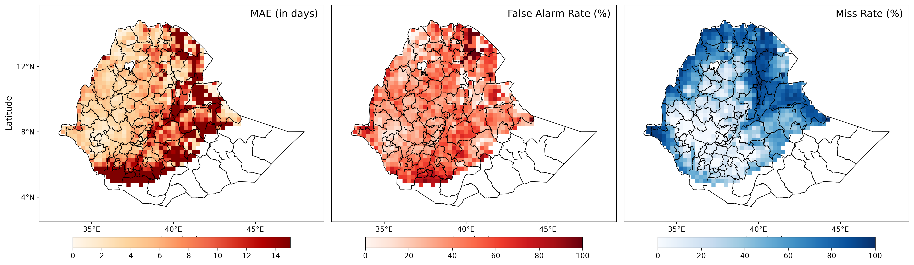{width=100% fig-alt="AIFS Single MAE, false-alarm ratio and miss rate for Days 1–15"}

::: {.smaller}
*Saved ROMP output; evaluation **2003–2023**: mean MAE **12.063985 days**, FAR **48.381761%**, MR **69.329382%**. Finite MAE/FAR/MR cells: **1523/1523/1633**.*

All three spatial means improve on climatology. Source: [matching saved NetCDF](../../data/ROMP_OUTPUT/aifs_single/spatial_metrics_aifs_single_1-15.nc).
:::

---

## AIFS Single: Days 16–30

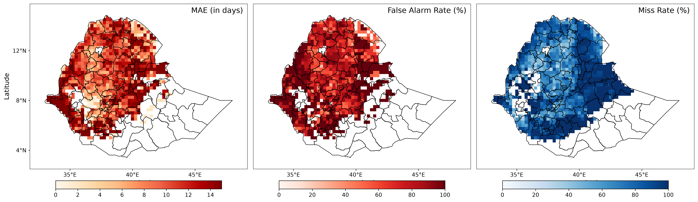{width=100% fig-alt="AIFS Single MAE, false-alarm ratio and miss rate for Days 16–30"}

::: {.smaller}
*Saved ROMP output; evaluation **2003–2023**: mean MAE **13.689181 days**, FAR **78.589832%**, MR **89.378463%**. Finite MAE/FAR/MR cells: **1413/1413/1580**.*

MAE remains slightly below climatology; FAR and MR are higher. Source: [matching saved NetCDF](../../data/ROMP_OUTPUT/aifs_single/spatial_metrics_aifs_single_16-30.nc).
:::

---

## FuXi: Days 1–15

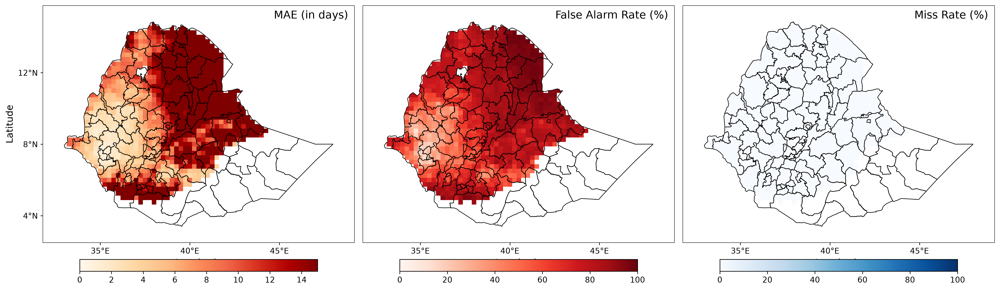{width=100% fig-alt="FuXi MAE, false-alarm ratio and miss rate for Days 1–15"}

::: {.smaller}
*Saved ROMP output; evaluation **2003–2023**: mean MAE **22.467227 days**, FAR **80.930369%**, MR **57.822453%**. Finite MAE/FAR/MR cells: **1650/1650/1644**.*

Lower MR than AIFS Single, but higher timing error and FAR. Source: [matching saved NetCDF](../../data/ROMP_OUTPUT/fuxi/spatial_metrics_fuxi_1-15.nc).
:::

---

## FuXi: Days 16–30

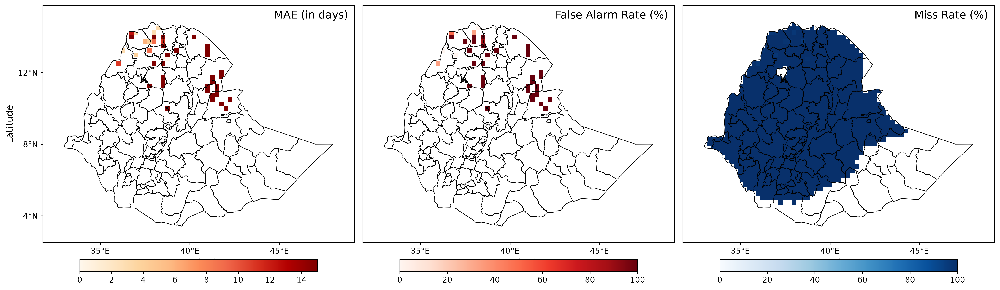{width=100% fig-alt="FuXi MAE, false-alarm ratio and miss rate for Days 16–30"}

::: {.smaller}
*Saved ROMP output; evaluation **2003–2023**: mean MAE **37.831716 days**, FAR **91.159061%**, MR **99.977602%**. Finite MAE/FAR/MR cells: **144/144/1642**.*

The MAE/FAR means describe far fewer cells than MR; the red palette saturates. Source: [matching saved NetCDF](../../data/ROMP_OUTPUT/fuxi/spatial_metrics_fuxi_16-30.nc).
:::

---

## GraphCast: Days 1–15

{width=100% fig-alt="GraphCast MAE, false-alarm ratio and miss rate for Days 1–15"}

::: {.smaller}
*Saved ROMP output; evaluation **2003–2023**: mean MAE **22.512079 days**, FAR **81.029685%**, MR **58.001124%**. Finite MAE/FAR/MR cells: **1650/1650/1644**.*

Similar to FuXi; these small differences do not establish a significant ranking. Source: [matching saved NetCDF](../../data/ROMP_OUTPUT/graphcast/spatial_metrics_graphcast_1-15.nc).
:::

---

## GraphCast: Days 16–30

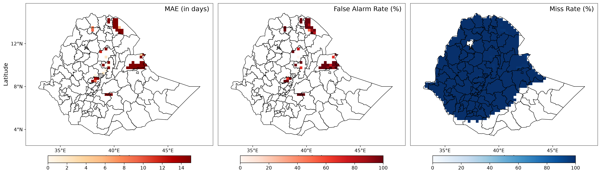{width=100% fig-alt="GraphCast MAE, false-alarm ratio and miss rate for Days 16–30"}

::: {.smaller}
*Saved ROMP output; evaluation **2003–2023**: mean MAE **53.495945 days**, FAR **96.006006%**, MR **99.992133%**. Finite MAE/FAR/MR cells: **111/111/1642**.*

Known observed dates can lie far outside the interval, producing large false-alarm timing errors. Source: [matching saved NetCDF](../../data/ROMP_OUTPUT/graphcast/spatial_metrics_graphcast_16-30.nc).
:::

---

## Climatology Reference: Days 1–15

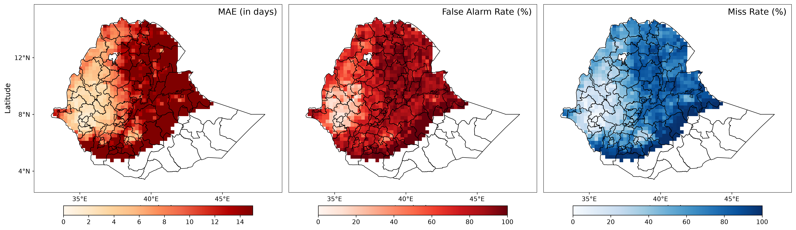{width=100% fig-alt="Climatology MAE, false-alarm ratio and miss rate for Days 1–15"}

::: {.smaller}
*Saved ROMP output; evaluation **2003–2023**: mean MAE **14.734372 days**, FAR **73.952505%**, MR **78.780621%**. Finite MAE/FAR/MR cells: **1050/1050/1066**.*

A mean onset day-of-year map is not a reference MAE/FAR/MR map. Source: [matching saved NetCDF](../../data/ROMP_OUTPUT/climatology/spatial_metrics_climatology_1-15.nc).
:::

---

## Climatology Reference: Days 16–30

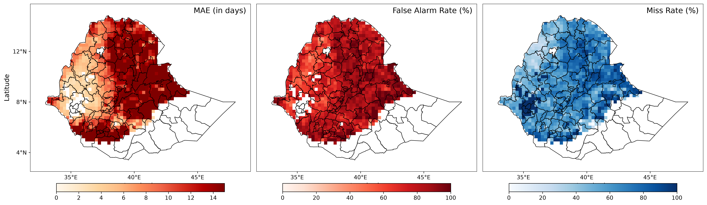{width=100% fig-alt="Climatology MAE, false-alarm ratio and miss rate for Days 16–30"}

::: {.smaller}
*Saved ROMP output; evaluation **2003–2023**: mean MAE **14.639968 days**, FAR **78.186080%**, MR **75.863183%**. Finite MAE/FAR/MR cells: **1023/1023/1065**.*

Use this window's reference when interpreting late-lead skill. Source: [matching saved NetCDF](../../data/ROMP_OUTPUT/climatology/spatial_metrics_climatology_16-30.nc).
:::

---

## Composite Plot: Model Minus Climatology

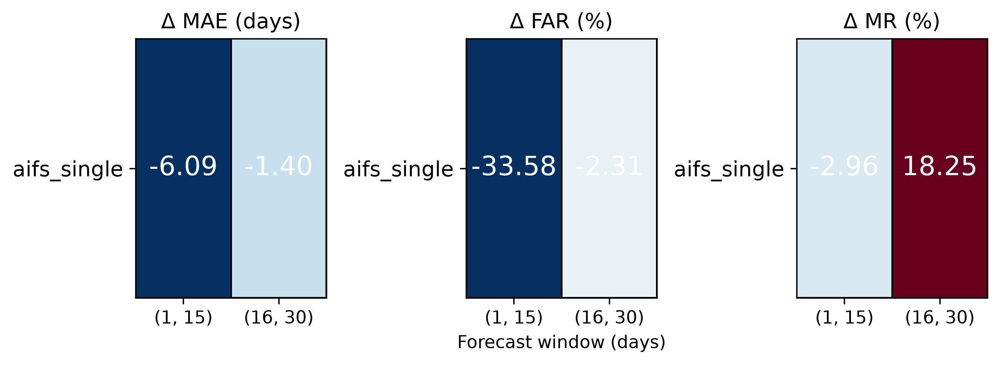{height=370px fig-alt="AIFS Single minus climatology differences in MAE, FAR and MR for both windows"}

::: {.smaller}
*Saved ROMP portrait (the plot type used in lesson Figure 6). AIFS Single differences of finite-cell means: **negative = lower error**, positive = higher error. FAR/MR differences are **percentage points**.*

The runner also saves separate FuXi/GraphCast portraits. There is no cross-metric average or ensemble error ranking. Sources: saved AIFS Single NetCDFs for [Days 1–15](../../data/ROMP_OUTPUT/aifs_single/spatial_metrics_aifs_single_1-15.nc) / [Days 16–30](../../data/ROMP_OUTPUT/aifs_single/spatial_metrics_aifs_single_16-30.nc), with the corresponding climatology outputs. The relative skill table below uses the matching saved finite-cell means.
:::

---

## Deterministic Skill Relative to Climatology

These **2003–2023 skill fractions** are computed from the finite-cell means in the matching saved NetCDFs. They summarize the same output set as the displayed ROMP maps.

| Model | Window | MAE skill | FAR skill | MR skill |
|:---|:---|---:|---:|---:|
| AIFS Single | 1–15 | 0.181235 | 0.345773 | 0.119969 |
| AIFS Single | 16–30 | 0.064945 | −0.005164 | −0.178153 |
| FuXi | 1–15 | −0.524817 | −0.094356 | 0.266032 |
| FuXi | 16–30 | −1.584139 | −0.165924 | −0.317867 |
| GraphCast | 1–15 | −0.527861 | −0.095699 | 0.263764 |
| GraphCast | 16–30 | −2.654103 | −0.227917 | −0.318059 |

::: {.callout-note}
Climatology is 0 by definition. Different finite-cell coverage limits direct ranking; portrait differences and relative skills have opposite improvement signs. Source: [deterministic_skill.csv](../../data/ROMP_OUTPUT/deterministic_skill.csv).
:::

---

## Probabilistic Snapshot: Preserve the Sample

- Requested evaluation: **2003–2023**; reference: **2007–2024**.
- Weekly Monday/Thursday initializations, anchored to calendar year **2024**, intersected with actual source dates.
- AIFS Ensemble: **25 members**; GenCast: **32 members**.

| Paired RPS accounting, per model/window | Cases |
|:---|---:|
| Forecast cases before paired filtering | 97,474 |
| Retained forecast cases | 78,498 |
| Excluded forecast cases | 18,976 |
| Excluded reference cases | 220,073 |

::: {.callout-warning}
These are initialization/grid-point cases, not independent samples or member counts. BS/BSS/AUC use pooled bin summaries; their sample scope is not asserted identical to paired RPS. Source: [AIFS Ensemble summary](../../data/ROMP_OUTPUT/aifs_ens/overall_skill_scores_aifs_ens_1-15.csv).
:::

---

## AIFS Ensemble: Days 1–15 Skill Heatmap

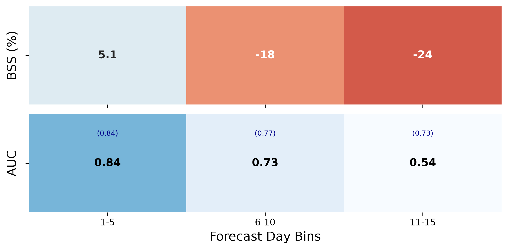{height=380px fig-alt="AIFS Ensemble five-day BSS percentages and AUC for Days 1–15"}

::: {.smaller}
*Lesson Figure 7a. BSS percentages round to **−43, −94, −28**. AUC is **0.703, 0.529, 0.503**, with reference AUC in brackets.*

Every bin has negative BSS; discrimination approaches chance by Days 11–15. Whole-window BSS **−0.558746**, RPSS **−0.496889** (fractions). Sources: [bins](../../data/ROMP_OUTPUT/aifs_ens/binned_skill_scores_aifs_ens_1-15.csv), [window](../../data/ROMP_OUTPUT/aifs_ens/overall_skill_scores_aifs_ens_1-15.csv).
:::

---

## AIFS Ensemble: Days 16–30 Skill Heatmap

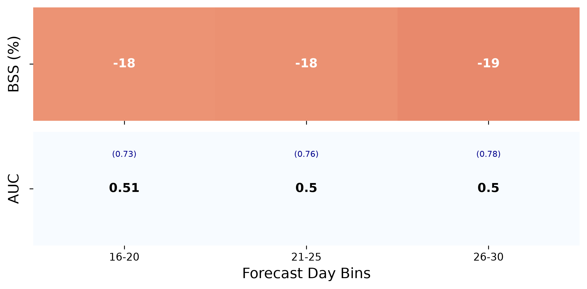{height=380px fig-alt="AIFS Ensemble five-day BSS percentages and AUC for Days 16–30"}

::: {.smaller}
*Lesson Figure 7b. BSS is about **−5%, −10%, −11%**; all three AUC values are approximately **0.5**. This heatmap does not show binwise RPSS.*

Whole-window BSS **−0.082356**, RPSS **−1.689344** (fractions). A smaller late-bin raw BS does not establish more skill. Sources: [bins](../../data/ROMP_OUTPUT/aifs_ens/binned_skill_scores_aifs_ens_16-30.csv), [window](../../data/ROMP_OUTPUT/aifs_ens/overall_skill_scores_aifs_ens_16-30.csv).
:::

---

## Whole-Window Ensemble Comparison

| Model | Window | AUC | Fair BSS (%) | Fair RPSS (%) |
|:---|:---|---:|---:|---:|
| AIFS Ensemble | 1–15 | 0.577447 | −55.87 | −49.69 |
| AIFS Ensemble | 16–30 | 0.501038 | −8.24 | −168.93 |
| GenCast | 1–15 | 0.783308 | −22.30 | 10.35 |
| GenCast | 16–30 | 0.624291 | −2.97 | −36.40 |

- GenCast has higher AUC in both windows, but this does not imply positive BSS.
- Positive early RPSS alongside negative BSS is possible: the event/distribution definitions and sample aggregation differ.
- A slightly positive GenCast **five-day** BSS does not imply positive **whole-window** late BSS.

::: {.smaller}
Sources: AIFS Ensemble [early](../../data/ROMP_OUTPUT/aifs_ens/overall_skill_scores_aifs_ens_1-15.csv) / [late](../../data/ROMP_OUTPUT/aifs_ens/overall_skill_scores_aifs_ens_16-30.csv); GenCast [early](../../data/ROMP_OUTPUT/gencast/overall_skill_scores_gencast_1-15.csv) / [late](../../data/ROMP_OUTPUT/gencast/overall_skill_scores_gencast_16-30.csv). All results are uncalibrated, uncrossvalidated reference comparisons.
:::

---

## Reliability: Read the Axes Before the Curve

- **x:** mean forecast probability; **y:** observed event frequency.
- Diagonal = perfect reliability; **above** = event occurred more often than predicted; **below** = less often.
- Grey bars = **fraction of forecasts**, on a logarithmic right axis; not raw counts.
- Error bars = binomial **one standard error**, not 95% confidence intervals.
- Each diagram verifies the **full-window event**, not its five-day bins.

::: {.callout-important}
The saved outputs contain PNGs but **no reliability-bin count CSV**. Interpret the curves qualitatively; save the diagnostic table or printed reliability log in a new experiment for exact counts.
:::

---

## AIFS Ensemble Reliability: Days 1–15

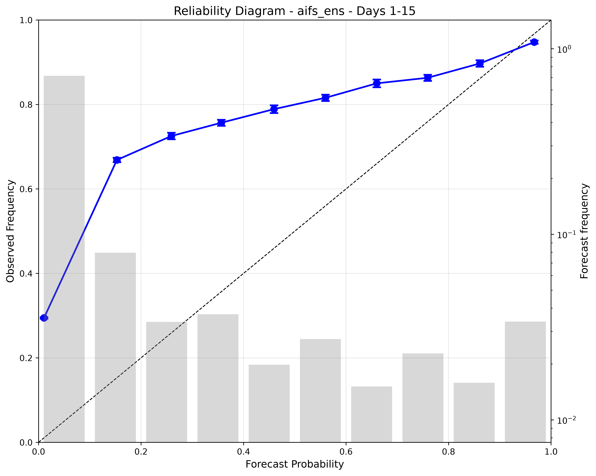{height=400px fig-alt="AIFS Ensemble reliability diagram for onset anywhere in Days 1–15"}

::: {.smaller}
*Lesson Figure 8a. Low- and middle-probability points lie above the diagonal: those probabilities **understate** observed frequency. The highest-probability point is slightly below it.*

This is not uniform overconfidence. Discuss the direction at each point; do not substitute these full-window frequencies for a five-day score.
:::

---

## AIFS Ensemble Reliability: Days 16–30

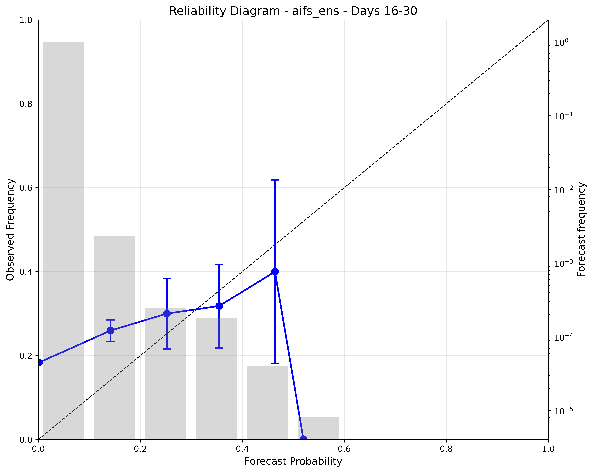{height=400px fig-alt="AIFS Ensemble reliability diagram for onset anywhere in Days 16–30"}

::: {.smaller}
*Lesson Figure 8b. Most forecasts occupy the lowest probability bin. The two higher populated points have much larger error bars.*

The apparent trend does not establish useful discrimination: overall AUC is **0.501038**. Exact bin counts are not saved.
:::

---

## Calibration, Resolution and Uncertainty

::::: {.columns}
::: {.column width="50%"}
### What is supported

- Metric-specific comparisons on the saved **0.25° prepared inputs**.
- Qualitative reliability diagnoses.
- Correlated grid-cell/initialization cases and unequal finite coverage.
:::
::: {.column width="50%"}
### What needs a new experiment

- **Calibration / IDR:** fit on separate years, evaluate held-out cases and preserve model versions.
- **1° resolution:** regrid rainfall consistently, redetect onset and recompute reference scores/sample sizes.
- **Significance:** use held-out years and suitable resampling before ranking small differences.
:::
:::::

::: {.callout-warning}
Neither calibrated improvements nor a numerical 1° comparison is included in the lesson. Calibration is not evidence that missing discrimination has been recovered.
:::

---

## Saved Output Sources and Reproducibility

::::: {.columns}
::: {.column width="100%"}
### Figures and source arrays

- All figures: `data/ROMP_OUTPUT/figures/`.
- Deterministic arrays: `data/ROMP_OUTPUT/<model>/spatial_metrics_*.nc`.
- Portraits and reference maps use `figures/climatology/`.
- Inside the container, paths start at `/app/`.

### Data used in these slides

- [Deterministic means and finite counts](../../data/ROMP_OUTPUT/deterministic_summary.csv).
- [Derived deterministic skill fractions](../../data/ROMP_OUTPUT/deterministic_skill.csv).
- Probability CSVs in `aifs_ens/` and `gencast/` under the same output root.
- Each caption links its matching data source.
:::
:::::

::: {.callout-note}
The deterministic summaries are derived from finite NetCDF values; relative skill is 1 minus the model mean divided by the corresponding climatology mean. Preserve input versions, periods, mask, onset settings and code revision. After rerunning a benchmark, regenerate figures and summaries together before presenting them.
:::

---

## Optional CLI Workflow: Run a Model

Use this alternative **after** the dashboard walkthrough; the exercises remain dashboard-based.

```bash
# Optional: enter the existing container, then work from /app

ssh -L 8501:localhost:8501 <you>@country-spark

docker exec -it -u 0 ai_weather bash
cd /app

# Choose one track and model
python run_momp.py --mode det --model AIFS
python run_momp.py --mode prob --model AIFS_ENS
```

- Catalog keys: DET **AIFS, FuXi, GraphCast**; PROB **AIFS_ENS, GenCast**.
- **Inside Docker**, `python` is `/opt/envs/app/bin/python`; the image already includes its application environment. No host `.venv` is needed for Docker.
- **Outside Docker only**, use `.venv/bin/python` if that host development environment is already configured.
- Preserve the actual settings, environment overrides and full execution log.

---

## Optional CLI Workflow: Batches and Reproduction

```bash
# Separate mode-specific batches; models run sequentially
python run_momp.py --mode det
python run_momp.py --mode prob

# Inspect the runner's supported options
python run_momp.py --help
```

- Configure paths in `ai_weather/config.py` / `.env`; confirm prepared inputs exist.
- The displayed deterministic grids record **2003–2023** evaluation years. Preserve the original configuration/log to reproduce their other settings.
- The saved probability snapshot uses **2003–2023** evaluation and **2007–2024** reference years. Current runs verify evaluation years outside the baseline using separate target-year observations; 2003–2006 are not errors merely because the baseline starts in 2007.

::: {.callout-warning}
These commands use the **current configuration**. Match it to the saved output metadata, original input versions and retained cases; changing settings creates a new experiment.
:::

---


# From Benchmark Scores to Farmer Messages

## Start with the Farmer's Decision

Use these question prompts before designing the message:

1. **Decision and lead time:** what must the farmer decide, and how far ahead—prepare land/seed, schedule planting, or wait?
2. **Required output:** a most likely onset week, its probability, or the probability that rainfall exceeds an agreed threshold?
3. **Trigger:** what probability should justify a specific message? For this MVP, test **at least 65% for one onset week**.
4. **Confidence and channels:** how will probability and uncertainty be expressed in local language, and delivered by SMS, voice or an extension agent?
5. **MVP infrastructure:** what inputs, computation, review, delivery and feedback are needed to produce and send the message?

::: {.callout-note}
This is a **proposed message-design exercise**, not an existing benchmark result or an implemented messaging feature. Agree the farmer decision and useful lead time with local users first.
:::

---

## Worked Example: Ethiopia Onset

| Design question | Proposed answer to test |
|:---|:---|
| **Farmer decision** | Plan land/seed preparation and a possible planting window over the next 1–2 weeks; confirm the required lead time locally |
| **Definition to test** | ICPAC-style agro-meteorological onset: three-day accumulation >20 mm, without a ≥7-day dry spell in the next 21 days; wet/dry cutoff 1 mm/day |
| **Output needed from model** | A distribution of first-onset dates, summarized as the **most likely onset week and its probability**, for a named location and issue date |
| **Steps to convert output to message** | Detect onset → aggregate daily probabilities into weeks → select the highest-probability week → apply the **65% gate** → review and communicate |
| **Additional considerations** | Full dry-spell follow-up, local rainfall biases, held-out reliability, crop/soil context, language, delivery access and updates |

::: {.smaller}
Definition source: [Scheuerer et al. (2024), Section 3.1, describing ICPAC operations](https://link.springer.com/article/10.1007/s00382-023-07085-y#Sec3). The **65% message trigger is an MVP design choice**, not part of the ICPAC onset definition.
:::

::: {.notes}
The cited definition uses wet days at least 1 mm/day and dry days below 1 mm/day. The current confirmation interval includes the candidate day; confirm this convention against the intended planting definition. Historical shortened searches do not demonstrate a complete 21-day veto for every candidate. Current runs reject insufficient forecast coverage instead of shortening the check. Preparation/planting lead time is a proposed user requirement, not a forecast-skill claim.
:::

---

## Required Output and the 65% Rule

For each location and issue date, let $p_d$ be the probability that **first qualifying onset** occurs on date $d$.

$$
P(W_j)=\sum_{d\in W_j}p_d,\qquad
W^*=\arg\max_j P(W_j)
$$

**Issue a specific most-likely-week message only when:**

$$
\text{quality checks pass}\quad\text{and}\quad P(W^*)\geq 0.65.
$$

- Use explicit, non-overlapping seven-day windows and print their calendar dates.
- Retain probability for **later / no qualifying onset within the assessed horizon**; do not renormalize only the displayed weeks to inflate confidence.
- A rainfall-threshold exceedance probability is not automatically an onset-week probability: onset also requires persistence and the dry-spell check.
- Apply the gate to the **unrounded probability**; round only the displayed message value.

::: {.callout-important}
Sum probabilities **within the same week**. Adding two different weeks to reach 65% does not justify naming either one as a 65%-probability onset week. Probability is not a statistical confidence interval.
:::

---

## Worked Probability Example: Send or Withhold?

**Illustrative distribution only—not measured ROMP output.** Issue date: **25 May 2024**; weeks are anchored to the day after issue.

| First-onset category | Probability |
|:---|---:|
| Week 1: 26 May–1 June | 10% |
| **Week 2: 2–8 June** | **65%** |
| Week 3: 9–15 June | 15% |
| Week 4: 16–22 June | 5% |
| Later / no qualifying onset within assessed horizon | 5% |
| **Total** | **100%** |

- **Trigger met:** Week 2 is most likely and reaches **65%**; issue the specific-week message **only if the quality checks pass**.
- **Trigger not met:** if the highest week is **40%** and the next is **35%**, withhold the specific-week message; communicate uncertain timing and the next update instead.

::: {.notes}
An illustrative Week 2 daily distribution is 5%, 8%, 12%, 15%, 10%, 9%, 6%; its sum is 65%. In raw ensembles probabilities are discrete: with 25 valid equally weighted members, at least 17 members must fall in one week (68%); 16/25 is only 64%. With 32 members, 21/32 is about 65.6%. The example is not claimed to be a saved 25-member forecast or a calibrated operational product.
:::

---

## Convert Model Output into a Message

1. **Check inputs:** location, issue/valid dates, rainfall units, member coverage, freshness and sufficient lead time for the full onset definition.
2. **Detect onset:** apply the chosen ICPAC-style rule to each member's daily rainfall. Check observations to establish whether onset has already occurred.
3. **Build the distribution:** estimate first-onset-date probabilities; retain unresolved/later outcomes and state any conditioning.
4. **Aggregate and select:** sum daily mass into agreed weeks and identify the highest-probability week.
5. **Validate probability quality:** check held-out reliability and skill for that event, location and lead; use approved calibration if supported.
6. **Apply the gate:** only a valid week's probability **≥65%** permits the specific-week template. Otherwise use the uncertain-timing/update template.
7. **Review, send and record:** retain the source forecast, rule version, probability, message, approval and delivery outcome.

::: {.callout-warning}
A BSS, AUC or reliability summary is **not** a weekly forecast distribution. The saved benchmark scores assess forecast quality; they do not by themselves supply the message probability.
:::

---

## Communicate Probability, Action and Uncertainty

::: {.callout-tip}
**Illustrative message, after quality checks and review:**

“For [woreda], forecast issued 25 May: rainy-season onset is most likely **2–8 June**, with **65% probability**. There is a **35% chance onset is not in that week**. Prepare for the possible window and check local soil conditions with your extension adviser before planting. Next update: [date].”
:::

- Keep the **location, issue date, week dates, probability and next update** in the message.
- Explain 65% as **about 65 out of 100 comparable forecasts**, subject to verified reliability—not a guarantee or “65% of the area will receive rain.”
- Test local-language wording with farmers. Use **SMS** for accessible text, **voice/IVR or extension agents** where literacy or connectivity requires it; select channels with users.
- If the gate fails, say **timing is uncertain**; do not issue a specific-week planting signal.

::: {.callout-note}
The lesson's saved forecasts are uncalibrated. This proposed communication rule must be tested on held-out cases; a threshold alone does not establish that probabilities are reliable.
:::

---

## MVP Infrastructure and Additional Considerations

| MVP component | Minimum function |
|:---|:---|
| **Input store and scheduler** | Receive versioned rainfall forecasts/observations; run when a fresh forecast is available |
| **Onset/probability worker** | Detect first onset, construct weekly probabilities, and retain complete follow-up/coverage diagnostics |
| **Decision and template service** | Apply the 65% gate and quality checks; populate approved local-language templates or uncertain-timing updates |
| **Review and delivery** | Assign a forecast/extension reviewer; send through the selected SMS/voice/agent channel and track delivery |
| **Evidence and feedback log** | Save inputs, configuration, probabilities, messages and delivery status; collect farmer comprehension and subsequent outcomes |

::: {.callout-important}
Agree update/expiry rules, local crop/soil relevance and the consequences of false and missed planting signals. Test whether **65%** is useful to farmers before operational deployment; revise it through documented validation and user feedback, not to force a message from every forecast.
:::

---

## Reporting Checklist

Every result should identify:

1. **Onset definition:** wet/dry parameters, full confirmation interval and available forecast coverage.
2. **Observation data:** product, version, variable, units and resolution.
3. **Model and sample:** requested/retained cases, initialization schedule/calendar and available members.
4. **Verification:** lead windows and timing tolerance.
5. **Reference:** source and reference period.
6. **Track and calibration:** DET or PROB; calibrated or uncalibrated.
7. **Provenance:** repository revision, environment/configuration/dashboard settings, input versions and missing metrics.

::: {.callout-note}
Keep the original CSVs, figures and execution log together. Do not infer exact reliability-bin counts or statistical independence from the image or total case count.
:::

---

## Troubleshooting the Benchmark

| Symptom | Check before interpreting a score |
|:---|:---|
| Run disabled or model absent | Catalog key, configured mask, source years, actual initialization dates and horizon coverage |
| Failure or stale result after switching tracks | Actual command/mode, selected model, saved settings and refreshed outputs |
| Blank cells or N/A | Mask, observations/predictions, metric-specific finite counts and nonzero reference denominator |
| High MR despite predicted events | Selected interval and saved method version; current reference counting differs from historical `timing_matched_v2` |
| MAE larger than 15 or 30 days | Known observed dates outside the window and the map's color cap |

::: {.callout-tip}
Preserve the complete log. Check input units and scientific Python dependency failures before treating a failed or stale run as a model result.
:::

---

## Core Lesson Conclusions

- Onset is derived from explicit rainfall rules; forecast-horizon truncation must be reported.
- Compare each **track and metric** against its appropriate reference, using documented cases and finite coverage.
- AIFS Single improves early MAE/FAR/MR against this deterministic reference; GenCast's positive early RPSS coexists with negative BSS.
- Read **FAR, MR and MAE together**; read **BSS with AUC and reliability**.
- The saved probability results are **uncalibrated**. Calibration, a 1° evaluation and significance claims require new processing and held-out verification.
- Use the **dashboard exercises** to change one setting, preserve evidence and explain the trade-off.
- For the proposed messaging MVP, name a most likely onset week only when its probability is **at least 65%** and the quality/review checks pass.

---

::: {style="display: flex; justify-content: center; align-items: center; height: 80vh; text-align: center;"}
## **Thank You**

:handshake: Questions and Discussion :handshake:

:::
