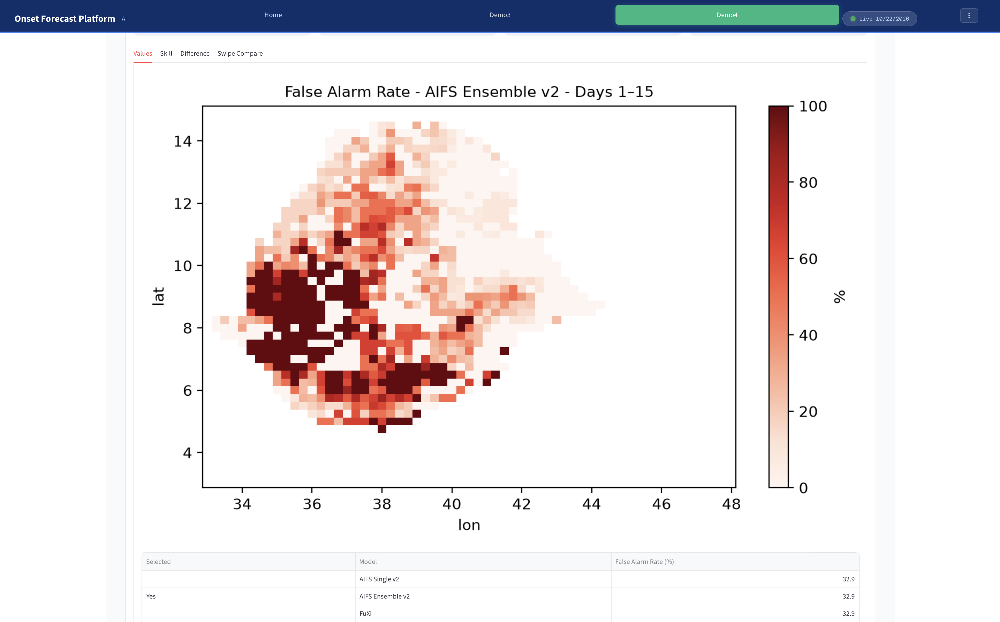
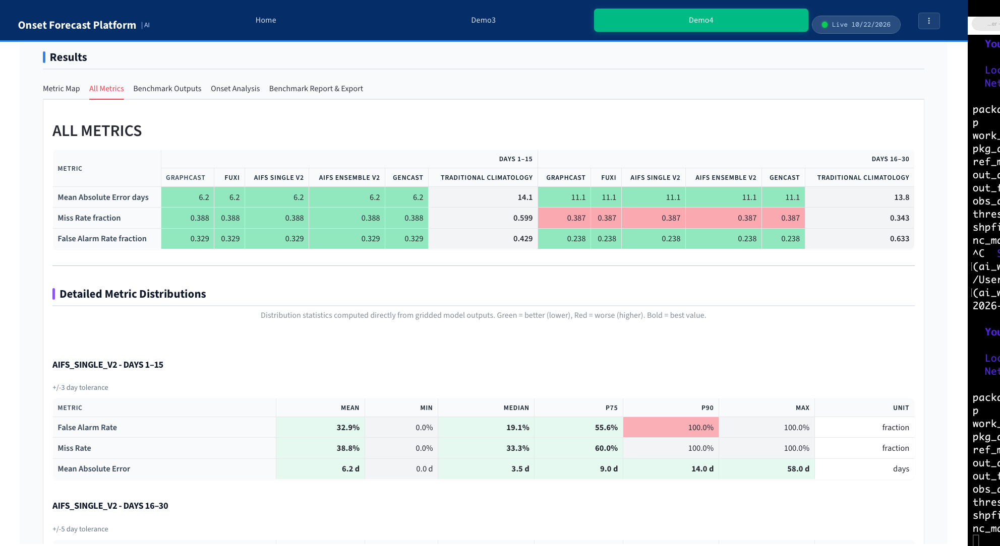

## Objectives

By the end of this session, participants will be able to:

1. **Understand** the core concepts and terminology of AI Weather Prediction (AIWP).
2. **Identify** the key model architectures and data sources used in our benchmark.
3. **Explain** the ROMP benchmarking workflow and why onset must be derived identically for observations and forecasts.
4. **Run** a benchmark, from the command line (`run_momp.py`) and from the dashboard, and check which settings a run really used.
5. **Interpret** deterministic and probabilistic evaluation metrics, and calculate skill scores relative to climatology.
6. **Translate** raw AI model outputs into actionable, impact-based weather messages.

---


## Monsoon Onset Parameters

Onset is **not** read directly from raw model output. To ensure genuine comparability, it is derived identically from daily rainfall data for observations and every forecast model, using strict rules:

| Parameter | Value | Meaning |
|:---|:---|:---|
| Observation variable | RAINFALL | Daily rainfall |
| `wet_init` | ≥ 1 mm | Rainfall that starts a candidate onset |
| `wet_threshold` | ≥ 20 mm/day | What counts as a wet day |
| `wet_spell` | 3 days | Consecutive wet days required |
| `dry_spell` | 7 days | Dry-spell length (days below `dry_threshold` = 1 mm/day) |
| `dry_extent` | 21 days | Window after the candidate in which a dry spell **vetoes** the onset |

::: {.callout-tip}
These rules ensure we capture a *sustained* onset, not an isolated rain event. A dry spell inside the veto window rejects the false start.
:::

---

## Data Lineage: What We Train On & Verify Against

Understanding the data is critical for trusting the output.

::: {style="font-size: 0.9em; line-height: 1.6;"}

1. **ERA5** | *TRAINING / INITIALIZATION*  
  Global atmospheric reanalysis (0.25°). The foundational "truth" the AI models learned from.
2. **CHIRPS** | *PRIMARY VERIFICATION*  
  Satellite- and station-blended precipitation dataset. The benchmark for this training and the dashboard.
3. **IMERG** | *SECONDARY VERIFICATION*  
  Global precipitation estimates from the GPM mission. Used for independent cross-validation.
4. **ENACTS** | *NATIONAL VERIFICATION*(Ethiopia, Kenya, Rwanda etcc)  
  Station-blended national product. Used in the earlier reference test runs, but **not** set up in the dashboard.
:::


::: {.callout-warning}
**Best Practice:** Verification and forecasts must be on a common 0.25° grid. Conclusions can change with the verification dataset, so always report which one you used.
:::

---

## Understanding the AI Models

The benchmark holds **five** models in two separate tracks:

| Track | Model | Origin |
|:---|:---|:---|
| Deterministic | AIFS Single v2 | ECMWF |
| Deterministic | FuXi | Fudan University |
| Deterministic | GraphCast | Google DeepMind |
| Probabilistic | AIFS Ensemble v2 (AIFS-ENS) | ECMWF |
| Probabilistic | GenCast | Google DeepMind |


::: {.callout-warning}
**Best Practice:** The ensembles models are much **slower** to run. fewer members or shorter evaluation periods are recommended for initial testing.
:::

.

---


## The ROMP Benchmarking Workflow

The Rainy season Onset Metrics Package (ROMP) ensures reproducible, quantitative evaluation. The workflow is strictly sequential:

1. **Config:** Define onset parameters, verification windows, and reference data.
2. **Load:** Fetch observations and model reforecasts.
3. **Derive:** Apply the **SAME** onset definition to both observations and forecasts.
4. **Match:** Match forecast onset to observed onset (per grid cell, per year, per init date) within a tolerance window: **3 days** for Days 1–15, **5 days** for Days 16–30.
5. **Compute:** Calculate metrics (strictly separated into Deterministic or Probabilistic tracks).
6. **Score:** Compute skill scores relative to a reference (e.g., climatology).

---

## The Golden Rule: Strict Track Separation

::: {.callout-important}
## Never mix tracks!

Deterministic and probabilistic models produce fundamentally different outputs and require non-comparable metric families. A single evaluation run must be exclusively one or the other.
:::

::::: {.columns}
::: {.column width="50%"}
### 1. Deterministic Track

- **MAE (Mean Absolute Error):** Average timing error in days.
- **FAR (False Alarm Ratio):** % of predicted onsets that did not occur.
- **MR (Miss Rate):** % of actual onsets that were missed.

*Tip: Read FAR, MR, and MAE together. A model that never predicts onset has 0% FAR but 100% MR.*
:::
::: {.column width="50%"}
### 2. Probabilistic Track

- **Brier Skill Score (BSS):** Improvement in probability accuracy over climatology.
- **Ranked Probability Skill Score (RPSS):** Distance between forecast and observed cumulative distribution.
- **AUC (Area Under ROC Curve):** Discrimination: can it separate event from non-event? 0.5 = no skill, 1.0 = perfect.
- **Reliability:** Do stated probabilities match observed frequencies? (Reliability diagram.)
:::
:::::

---

## Understanding Skill Scores

Raw metrics alone do not establish whether an AI model beats a naive baseline. We use a Skill Score ($SS$) relative to a reference (usually climatology):

$$
SS = 1 - \frac{\text{Metric}_{\text{model}}}{\text{Metric}_{\text{reference}}}
$$

**Interpretation:**

- $SS = 1$: Perfect forecast.
- $SS > 0$: The model **outperforms** the reference (positive skill).
- $SS = 0$: The model performs identically to the reference.
- $SS < 0$: The model performs **worse** than the reference (negative skill).

*This applies to metrics where lower is better: MAE, FAR, MR, BS, RPS. For AUC, higher is better, so compare it directly with the climatology AUC.*

---

## What the Case Study Found

::::: {.columns}
::: {.column width="50%"}
### Deterministic (Days 1–15 vs 16–30)

- Every model is **better at short lead** than at long lead.
- By Days 16–30 the advantage over climatology largely disappears.
- **AIFS:** strongest at short lead, errors grow fast.
- **GraphCast:** best detection, but **frequent false alarms**.
- **FuXi:** few false alarms, but a **very high miss rate**.
:::
::: {.column width="50%"}
### Probabilistic (AIFS-ENS sample run)

- Positive skill only in Days 1–5 (BSS ≈ **+6 %**).
- AUC falls from **0.85** (Days 1–5) to **0.53** (Days 11–15) and **0.50** in Days 16–30.
- Overconfident: near-zero forecasts verify about 8 % of the time.
- Calibration (IDR) can fix reliability, **not** missing discrimination.
:::
:::::

::: {.callout-warning}
Blank cells on a metric map mean the metric is **undefined** (no matched onset), not "perfect".
:::

---


## Map Visualization

::: {style="display: flex; justify-content: center; align-items: center; height: 50vh; text-align: center; background-color: #f8f9fa; border: 2px dashed #dee2e6; border-radius: 8px;"}

 


:::

::: {.callout-tip}
## Discussion

Look at the map. Where do the models show the highest agreement for onset timing? Where is the uncertainty highest? Remember: blank cells often mean the metric is undefined, not that the model is "perfect."
:::

---


# Hands-On Benchmarking

## Two Ways to Run the Same Benchmark

Both start the same program, `run_momp.py`, so they give the same results.

| | **Track A: command line** | **Track B: dashboard** |
|:---|:---|:---|
| You use | `python run_momp.py ...` | The Forecast Benchmarking page |
| Best for | Reproducible runs, changing the onset definition | Choosing models, running, exploring maps and tables |

Set-up is shared: **Docker** (recommended) or a **local uv environment**.

---

## What You Need

| Item | Notes |
|:---|:---|
| Docker | `docker --version` |
| GPU | **Optional**. The benchmark scores saved forecasts on CPUs: start with `GPU=0` |
| Data in `~/data/external` | CHIRPS, region mask, model forecasts. Missing inputs are read from the Google bucket |
| `.env` (optional) | `DEMO_BUCKET=<bucket-name>`, `ROMP_REGION=Ethiopia`. One `KEY=value` per line, **no quotes** |
| Browser | For the dashboard |

```bash
git clone https://github.com/MBZUAI-Aim-For-scale/training-program-2026.git
cd ai_weather
mkdir -p ~/data/external ~/data/ROMP_OUT
```


## Track A: Run from the Command Line

```bash
# One deterministic model
bash docker/run.sh momp --mode det --model AIFS

# One probabilistic model (much slower)
bash docker/run.sh momp --mode prob --model AIFS_ENS

# All models of a track, one after another
bash docker/run.sh momp --mode det
```

| Option | Meaning |
|:---|:---|
| `--mode det` / `prob` | The track. Always give it. **Never mix.** |
| `--model` | Catalog key: `AIFS`, `FuXi`, `GraphCast`, `AIFS_ENS`, `GenCast` |
| `--spec file.json` | Change the onset definition or period |

Local environment: `python run_momp.py --mode det --model AIFS`

---


## Open the Dashboard

1. **Tunnel** (only for a remote server; keep this terminal open):

   ```bash
   ssh -L 8501:localhost:8501 <username>@country-spark
   ```

2. Open **<http://localhost:8501>**.
3. In the sidebar, open the page named **short medium benchmarking** (its title reads *Forecast Benchmarking*).

The tiles at the top show the models, presets, run **status** (Idle, Completed, Failed) and the output folder.

---

##  Configure and Run

::: {.smaller}
1. **Benchmark inputs:** Ground truth **CHIRPS**; Coverage **Ethiopia** (the only country set up; others disable the run button); Forecast window `1-15 days`.
2. **Models:** filter by category, then click rows to select. Start with **one deterministic model (AIFS)**. Ensembles are slow.
3. **Model run windows:** keep the proposed **fair-comparison window**. Initialization days `0, 3` = Monday and Thursday.
4. **Advanced Temporal & Verification Settings:** leave the defaults.
5. **Run Benchmark.** Models run one after another. A live panel shows elapsed time and the last lines of output.
:::

::: {.callout-warning}
**Do not click anything on the page while a run is in progress.** It interrupts the run (exit code -15). A run is stopped after 30 minutes.
:::

---

## Which Dashboard Settings Reach the Run?

| Dashboard panel | Reaches the run? | Where to change it |
|:---|:---|:---|
| Advanced Temporal & Verification | **Yes** | The panel |
| Inputs, evaluation window, baseline years, init days, forecast window | **Not yet** | Spec file (Track A) or `config.py` |
| **Shared settings** (wet-day threshold, dry spell, ...) | **Not yet** | Spec file (Track A) or `config.py` |

::: {.callout-important}
The panel shows a dry-spell search extension of **0**, but the configuration uses **21**. A window of 0 would switch off the veto against false starts. Always read the **`Onset`** line in the run summary.
:::

::: {.notes}
Remove the "Not yet" rows once the page writes the run specification (ROMP_SPEC_PATH), and set the panel default of the dry-spell search extension to 21 first.
:::

---


## Read the Run Summary

Every run starts with the settings it will use. **Read it before the run goes on.**

```
MOMP [DET]  model=AIFS  (catalog key: AIFS)
obs_dir       : /app/data/external/CHIRPS/Ethiopia
Years         : (2003, 5, 1) -> (2023, 7, 31)
Baseline years: 2007 -> 2024
Init          : type=weekly days=(0, 3) date_filter_year=2024
Onset         : wet_init=1 wet_threshold=20 wet_spell=3
                dry_threshold=1 dry_spell=7 dry_extent=21
Windows       : ((1, 15), (16, 30))
Tolerances    : (3, 5)
...
MOMP [DET] AIFS: completed.
```

Check success: `echo $?` → `0`, and new files in `~/data/ROMP_OUT/et/output`.


## Exercise: Threshold Sensitivity

1. Run AIFS with `wet_day_threshold: 20`. Copy the results: `cp -r ~/data/ROMP_OUT/et ~/data/ROMP_OUT/et_base`.
2. Change it to `30` in a copy of the spec, run again, copy to `et_test`.
3. Compare the **Miss Rate** and **False Alarm Rate** maps. Which moved more? Did the model ranking change?
4. Write down what you would have to **report** for each run.

::: {.fragment}
**Why copy?** Runs write to the same folder, so a second run overwrites the first.
:::

---

## Exploring Results & Exporting

After the benchmark finishes, the page refreshes and fills the **Results** section:

1. **Metric Map:** FAR, Miss Rate or MAE maps; sub-tabs *Values*, *Skill*, *Difference*, *Swipe Compare*. Clip to an admin region if a shapefile is configured.
2. **All Metrics:** a colour-coded table against climatology (green = better, red = worse), plus detailed distributions (Mean, Min, Median, P75, P90, Max).
3. **Benchmark Outputs:** PNG figures by model type, and the raw NetCDF files.
4. **Onset Analysis:** onset time series for coordinates or a woreda.
5. **Skill vs Baseline** and **Uncertainty:** skill against climatology; bootstrap confidence intervals and significance.
6. **Benchmark Report & Export:** *Generate Complete PDF Report*, then *Download*.

::: {.smaller}
Tabs 4–6 appear only when their optional modules are installed. Results from the command line show up here after a page reload.
:::

---

## Reading the Metric Map Correctly

::: {.callout-warning}
## Two different meanings of "skill"

The **Skill** sub-tab is only a pass/fail map: green where the metric is below a fixed threshold (FAR 35 %, Miss Rate 60 %, MAE 7 days). It is **not** the skill score $SS$.
:::

- **Difference** = selected map minus comparison map. Red means the selected map is higher, which is *worse* for FAR, MR and MAE.
- **All Metrics** colours are relative to **climatology**, so a model can be green on MAE and red on Miss Rate.
- A model that rarely predicts onset has few false alarms and few cells for MAE: read all three together.

---

## When Something Goes Wrong

| You see | Likely cause | Do this |
|:---|:---|:---|
| Empty Models table | No `.nc` files found | `bash docker/run.sh check`, fix the `MISSING` line |
| "No data is configured for ... yet", Run disabled | Country not set up | Select Ethiopia |
| 401 / "credentials" error | A `[bucket]` input and no Google login | `gcloud auth login`, or use local data |
| Exit code **-15** | The page was touched during a run | Wait, then rerun |
| Exit code **-9** | Out of memory | Fewer models, shorter period |
| Exit code **124** | Longer than 30 minutes | Shorter period, one model at a time |
| "container is not running" | Not started | `bash docker/run.sh`, then `logs` |
| Start fails on `nvidia.com/gpu` | No GPU for Docker | `GPU=0 bash docker/run.sh` |
| Changing a Shared setting does nothing | Not sent to the run yet | Use a spec file |

---

## Knowledge Check: Quick Review

Let's test our understanding. Think first, then reveal the answer.

1. What dataset serves as our primary observational benchmark for verification?

   ::: {.fragment}
   *CHIRPS.*
   :::

2. Why must we apply the exact same wet/dry spell rules to both observations and forecasts?

   ::: {.fragment}
   *To ensure genuine comparability: onset is a derived event, not a raw variable.*
   :::

3. A model has a Brier Skill Score of −0.15. What does that mean?

   ::: {.fragment}
   *Its Brier score is about 15 % higher (worse) than the climatological reference.*
   :::

---

## Knowledge Check: Hands-On

4. A run fails with exit code -15 and no error message. What happened?

   ::: {.fragment}
   *The page was touched while the run was in progress. Wait for a run to finish, then rerun.*
   :::

5. BSS is negative and AUC is 0.50 in Days 16–30. Can IDR rescue it?

   ::: {.fragment}
   *No. AUC = 0.5 means there is no discrimination to calibrate. IDR fixes overconfidence only.*
   :::

6. You change the wet-day threshold in the dashboard's Shared settings and the results do not change. Why, and what do you do?

   ::: {.fragment}
   *Those settings are not sent to the run yet. Use a spec file (`--spec`) and check the `Onset` line in the summary.*
   :::

---


# Worksheet  for AI Weather Model Benchmarking

### Data Readiness Check

**Action:** Run `python ai_weather/config.py sync` in your terminal.

::: {.callout-question}
**Question 1.1:** Are all observations (CHIRPS), region mask, and AIFS model inputs marked as `ok`?
:::


### Track Rule Check

::: {.callout-warning}
**Question 1.2:** Why must deterministic (MAE, FAR, MR) and probabilistic (BSS, AUC) evaluation tracks remain strictly separated?
:::

> **Key Principle:** Non-comparable metric families must be evaluated independently to prevent statistical contamination and ensure fair, mathematically sound comparisons.

---

## Part 2: Run Dashboard Benchmark


1. **Select Region:** Your country of interest (e.g., Kenya)
2. **Ground Truth:** CHIRPS
3. **Window:** 1–15 days
4. **Model:** AIFS ENSEMBLE
5. **Action:** Choose the same evaluation window, then click **Run Benchmark**.

::: {.callout-question}
**Question 2.1:** Did the run status tile change to **Completed** without page interruption?
:::

::: {.callout-note}
**Troubleshooting Tip:** Exit code `-15` means the background script was interrupted. *Leave the page idle during execution.*
:::

---

## Part 3: Map & Skill Evaluation


Navigate to the **Metric Map** tab and view **Miss Rate** for Days 1–15.

::: {.callout-question}
**Question 3.1:** In which region of Ethiopia is the AIFS miss rate highest, and why is onset harder to forecast there?
:::

## Skill vs. Climatology Comparison

Go to the **All Metrics** tab and compare AIFS against Traditional Climatology.

::: {.callout-question}
**Question 3.2:** Fill out the scorecard below:
:::

| Metric | Better or Worse than Climatology? | Cell Color (Green/Red) |
| :--- | :---: | :---: |
| **Mean Absolute Error (MAE)** | | |
| **Miss Rate (MR)** | | |
| **False Alarm Rate (FAR)** | | |

---

## Part 3: Metric Trade-Off Reflection

::: {.callout-important}
**Question 3.3:** If a model predicts rainy season onset *every single day*, what will its Miss Rate and False Alarm Rate be? Why must we read MAE, FAR, and MR together?
:::

::: {.fragment}
**Answer Insight:** 
- **Miss Rate (MR):** ~0% (it never misses an onset because it always predicts one).
- **False Alarm Rate (FAR):** ~100% (almost every prediction is a false alarm).
- **Takeaway:** MAE is calculated *strictly on matched onset events*. A model that rarely predicts onset will have a deceptively low MAE despite missing almost all events. Metrics must be evaluated holistically.
:::

---

## Core Lesson Guiding Questions

How do we systematically approach AI weather benchmarking?

1. **Systematic Benchmarking:** How do we benchmark AI models against local observations for rainy season onset?
2. **Track Separation:** How do deterministic and probabilistic evaluation tracks differ, and why must they remain strictly separated?
3. **Dashboard Operations:** How do we run a benchmark from the dashboard, and how do we read its outputs?
4. **Data Verification:** Where does the benchmark data come from, and what do we do when it is missing?
5. **Pipeline Control:** How do we configure, run, and troubleshoot the ROMP/MOMP pipeline reliably?

---

## Data Setup & Configuration FAQs

| Question | Resolution |
| :--- | :--- |
| **"No forecast model data detected"** | Run `python ai_weather/config.py`. Ensure `.nc` files exist under `~/data/external` or check cloud bucket. |
| **"Run Benchmark" button greyed out** | Selected coverage lacks configured data/mask files. Only configured regions (e.g., Ethiopia) are enabled. |
| **`[local]` vs `[bucket]` in config** | Local disk is checked first, falling back to Google Bucket. Bucket paths are read directly without downloading. |
| **"401" or "Anonymous caller" errors** | Authenticate via `gcloud auth login` or place data locally under `~/data/external`. |
| **Do I need a GPU?** | **No.** Benchmarking evaluates pre-computed forecasts on CPUs. GPUs are only for generating raw inferences. |

---

## Model Selection & Evaluation Windows

::: {.columns}
::: {.column width="50%"}
**Forecast Types**
- **LIVE FORECAST:** Model data extends into the last two years.
- **HISTORICAL:** Older reforecast datasets.

**Initialization Days**
- **Day 0:** Monday
- **Day 3:** Thursday  
*(Standard twice-weekly reforecast initializations)*
:::
::: {.column width="50%"}
**Fair Comparison**
- Reforecast availability varies. The **fair-comparison window** identifies the common overlapping date range across all selected models.

**Ensemble Models (AIFS-ENS, GenCast)**
- Slower to evaluate because they compute metrics across *multiple forecast members* per initialization date.
:::
:::

---


## Interpreting Metrics & Results

| Topic | Interpretation |
| :--- | :--- |
| **Blank (white) cell on map** | Metric is *undefined* at that grid point (no onset occurred/matched). Blank $\neq$ perfect performance. |
| **Lower is Better** | MAE, False Alarm Rate (FAR), Miss Rate (MR), Brier Score (BS), Ranked Probability Score (RPS). |
| **Higher is Better** | Area Under ROC Curve (AUC), Skill Scores (SS). |
| **Skill Map vs. Skill Score** | **Skill Map:** Pass/fail mask (FAR $\le$ 35%, MR $\le$ 60%, MAE $\le$ 7 days). **Skill Score:** Mathematical ratio measuring improvement over climatology. |

---


## Probabilistic Evaluation & Science FAQs

::: {.callout-question}
**How can Brier Skill Score (BSS) be negative while AUC is high?**
:::
::: {.fragment}
**Answer:** AUC measures *discrimination* (separating event vs. non-event). BSS evaluates *probability accuracy and calibration*. An uncalibrated/overconfident ensemble can discriminate well but score poorly on BSS.
:::

::: {.callout-question}
**Why evaluate derived onset rather than raw precipitation?**
:::
::: {.fragment}
**Answer:** Agricultural decision-making depends on *sustained* rainy season onset (wet spells without early dry-spell vetoes). Derived onset rules apply identical criteria to observations and models for fair evaluation.
:::

---


## Practical Exercises (Part 1)

::: {.callout-tip}
**Exercise 1 (Configuration Analysis):** Open the benchmark config file. Locate `wet_threshold`, `wet_spell`, and `dry_spell`. Predict how increasing `wet_threshold` affects FAR and MR.
:::

::: {.callout-tip}
**Exercise 2 (Map Interpretation):** Analyze deterministic maps for AIFS, FuXi, and GraphCast. Identify which model over-predicts onset (high false alarms) and which under-predicts (high miss rate). Explain why low FAR alone does not guarantee a good forecast.
:::

::: {.callout-tip}
**Exercise 3 (Summary Metrics Reconciliation):** Explain why spatial maps might show localized MAE improvements while national summary tables report negative overall skill scores.
:::

---

## Practical Exercises (Part 2)

::: {.callout-tip}
**Exercise 4 (Skill Score Calculation):**  
Given: Model BS = 0.0849, Climatology BS = 0.0907 (Days 1–5).  
Compute BSS: $BSS = 1 - \frac{BS_{model}}{BS_{ref}}$  
*Repeat for Days 11–15:* Model BS = 0.1307, Ref BS = 0.0990.
:::

::: {.callout-tip}
**Exercise 5 (Reliability & Discrimination):** Examine a reliability diagram where the curve is flat and AUC is 0.50. Does the model possess predictive discrimination skill? Explain.
:::

::: {.callout-tip}
**Exercise 6 (Threshold Sensitivity):** Using command-line config overrides, increase `wet_threshold` from 20 mm to 30 mm. Compare resulting MR and FAR spatial maps against the baseline run.
:::

::: {.callout-tip}
**Exercise 7 (Benchmark Experiment Design):** List the seven required elements in the reporting checklist that must be documented when publishing any weather benchmark result.
:::


::: {style="display: flex; justify-content: center; align-items: center; height: 80vh; text-align: center;"}
## **Thank You**  

:handshake: Questions and Discussion :handshake:  

:::
